[TOC]

# Primeros pasos

> [!IMPORTANT]
>
> Una vez terminado el módulo de Word, en Excel encontramos **numerosos aspectos que se asemejan**, por lo que no es necesario repetirlos en su totalidad. **Nos enfocaremos en las diferencias**. Por ejemplo, el manejo de imágenes y el formato de tablas es idéntico al de Word, por lo que no será necesario repetirlo.

## Introducción

https://support.microsoft.com/es-es/office/aprendizajes-en-v%C3%ADdeo-de-excel-9bc05390-e94c-46af-a5b3-d7c22f6990bb

Excel es un **programa informático de hoja de cálculo** desarrollado por Microsoft y forma parte de la suite de Office.

- **¿Qué es Excel?**
  - Excel es una **aplicación de hoja de cálculo** que nos permite formatear, organizar y calcular datos en una cuadrícula compuesta por filas y columnas.
  - Cada recuadro en esta cuadrícula se llama **celda**, y en ella podemos ingresar datos numéricos y de texto.
  - A diferencia de un procesador de textos, como Microsoft Word, en Excel los datos están organizados como una tabla, lo que facilita el trabajo con números y fórmulas matemáticas.
- **¿Para qué sirve Excel?**
  - Excel pertenece a la categoría de programas informáticos conocida como **hojas de cálculo**.
  - Algunos usos comunes de Excel incluyen:
    - **Análisis de negocios**: Se utiliza para analizar datos financieros, realizar proyecciones y crear informes.
    - **Gestión de recursos humanos**: Para llevar registros de empleados, nóminas y horarios.
    - **Contabilidad y presupuestos**: Excel es ampliamente utilizado en tareas contables y financieras.
    - **Elaboración de gráficos y tablas dinámicas**: Permite visualizar datos de manera efectiva.
    - **Gestión de proyectos**: Excel ayuda a planificar y hacer seguimiento de tareas y plazos.

Excel es una herramienta poderosa que nos permite trabajar con datos numéricos y realizar cálculos, análisis y representaciones gráficas.

## Crear un nuevo libro

En Excel, los nuevos documentos se denominan **Libros**. Un libro es un archivo de Excel que contiene una o más **hojas** donde puedes ingresar y almacenar datos. Cada hoja en un libro está compuesta por una gran cantidad de celdas que pueden contener datos organizados según tus necesidades. Por lo tanto, un libro de Excel es como un contenedor que alberga varias hojas, y cada hoja es una pestaña dentro de ese libro. 

De forma predeterminada, al crear un nuevo libro, se crea una hoja. Se pueden añadir tantas hojas como necesites al mismo libro.

Al iniciar Excel aparece una **pantalla inicial** como esta:

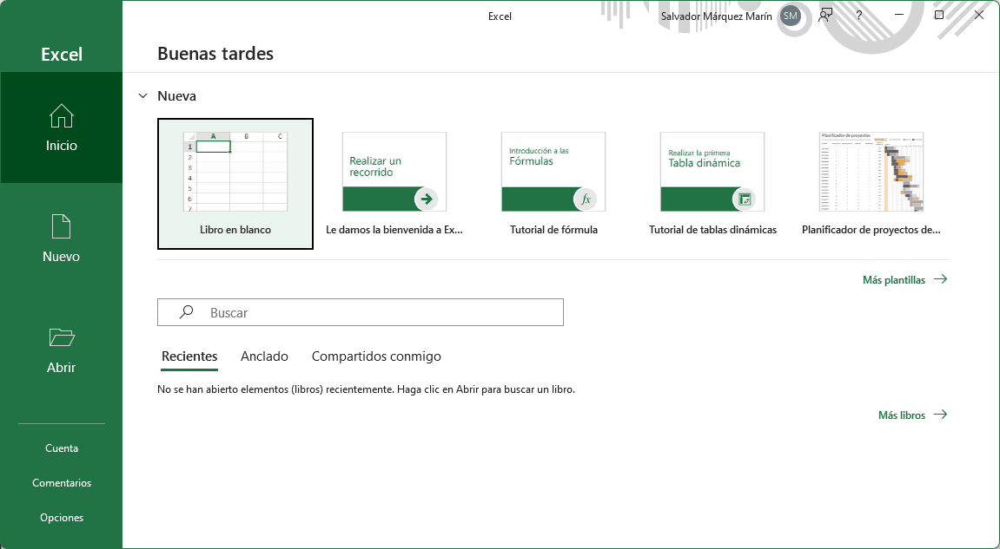{.rounded-4}

Si abrimos un **Libro en blanco**, clicando sobre la primera opción del menú de la derecha, se nos mostrará una hoja de cálculo. Vamos a ver sus componentes fundamentales: así conoceremos los **nombres de los diferentes elementos** y será más fácil entender el resto del curso. 

La pantalla que se muestra a continuación (y en general todas las de este curso) puede no coincidir exactamente con la que ves en tu ordenador, ya que cada usuario puede decidir qué elementos quiere que se vean en cada momento.

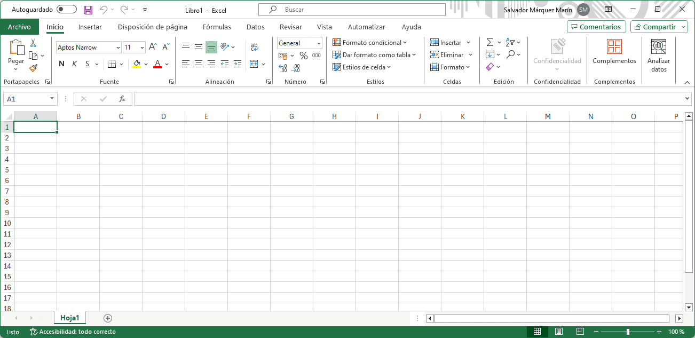{.rounded-4}

## Entorno

El entorno es muy parecido al de Word, la pestaña archivo tiene las mismas opciones, la barra de título, estado, acceso rápido son prácticamente iguales, los cambios más significativos son los siguientes:

🟩**Cinta de opciones**

Las **fichas principales** son **Inicio**, **Insertar**, **Diseño de página**, **Fórmulas**, **Datos**, **Revisar** y **Vista**. En ellas se encuentran los distintos botones con las opciones disponibles.

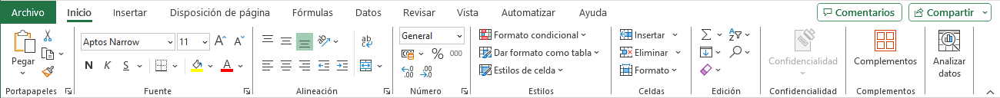{.rounded-2}

🟩**Barra de fórmulas**

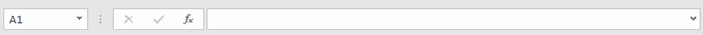{.rounded-2}

Nos **muestra el contenido de la celda activa**, es decir, la casilla donde estamos situados. Cuando vayamos a modificar el contenido de la celda, dicha barra variará ligeramente, pero esto lo estudiaremos más adelante.

🟩**La barra de etiquetas**

{.rounded-2}

Está ubicada en la esquina inferior izquierda y permite **movernos por las distintas hojas** del libro de trabajo, así como gestionarlas (añadir, borrar, moverlas, renombrarlas, etc.).

## Empezando a trabajar con Excel

### Celdas

Las hojas están divididas en celdas. Las filas están referenciadas con letras, y las columnas con números, de forma que para hacer referencia a una celda concreta, tenemos que usar su letra y su número.

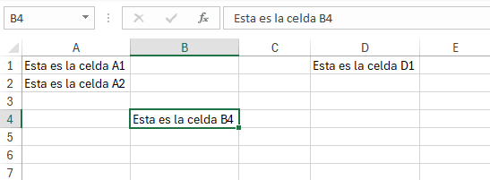{.rounded-2}

- Fíjate que cuando seleccionamos una celda, en la **barra de fórmulas** sale su ubicación (`B4`) y el valor que contiene (`Esta es la celda B4`).
- Hemos puesto un texto en unas celdas cualquiera, para que veas como podemos referenciar una celda en concreto.

### Introducir datos

En cada una de las celdas de la hoja es posible **introducir textos, números o fórmulas**. En todos los casos, los pasos a seguir serán los siguientes:

Situar el cursor sobre la celda donde se van a introducir los datos y teclear los datos que desees introducir.

Aparecerán en dos lugares: en la **celda activa** y en la **Barra de Fórmulas**, como puedes observar en el dibujo siguiente:

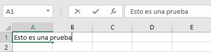{.rounded-2}

Para introducir el valor en la celda puedes utilizar cualquiera de los tres métodos que te explicamos a continuación:

🟩**INTRO**: Se **valida el valor** introducido en la celda y además la **celda activa pasa a ser la que se encuentra justo por debajo**.

🟩**TECLAS DE MOVIMIENTO** : Se **valida el valor** introducido en la celda y además **la celda activa cambiará dependiendo de la flecha pulsada**. Por ejemplo, si pulsamos <kbd>Cursor➡️</kbd> será la celda contigua hacia la derecha.

> [!NOTE]
>
> Se entiende por "**valida el valor**" como "**se comprueba si el valor introducido es válido o no**". Ahora mismo introducimos un texto cualquiera, y lo da por válido, pero ya veremos más adelante que podemos poner restricciones a los valores introducidos, como por ejemplo, que una celda solo admita números entre 0 y 10, o solo pueda tener un texto con "Si" o "No".

## 👩‍🏫Ejercicio 1

Vamos a crear nuestro primer libro y a introducir algunos datos para familiarizarnos en Excel.

**1** Si no tienes abierto Excel, ábrelo para realizar el ejercicio. Crea un nuevo libro en blanco.

**2** Sitúate en la celda **A1** y escribe **1995**.

**3** Pulsa la tecla <kbd>INTRO</kbd>.

💡Este es un dato de tipo número, y por defecto Excel lo alinea a la derecha.

**4** Sitúate en la celda **A2** y escribe **1.995** y pulsa la tecla <kbd>INTRO</kbd>.

💡Los números se pueden escribir con o sin punto de miles. Excel también lo alinea a la derecha.

**5** Sitúate en la celda **A3** y escribe **1995,12**

**6** Pulsa <kbd>FLECHA ABAJO</kbd>

💡Excel por defecto admite como símbolo decimal la coma "`,`" y sus reglas corresponden a las de cualquier número decimal. Observa también que al pulsar <kbd>FLECHA ABAJO</kbd>, al igual que con la tecla <kbd>INTRO</kbd>, se introducirá el valor de **A3** y automáticamente el cursor se posicionará en la celda inferior.

**7** Escribe **12345678901234** en la celda A4

**8** Pulsa <kbd>FLECHA ABAJO</kbd>

💡Si el número no cabe en la celda, Excel lo visualizará con formato Exponencial, aparecerá 1,23457E+13 que equivale a 1,234567*1013.

**9** Escribe **-2950** en la celda A5

**10** Pulsa <kbd>INTRO</kbd>

💡Para introducir un valor negativo, basta con escribir el signo "-" delante del valor numérico.

**11** Sitúate en la celda A6 y escribe **(2950)**

**12** Pulsa <kbd>INTRO</kbd>

💡Excel también lo tomará como un valor numérico negativo y lo modificará por -2950 tanto en la celda como en la Barra de Fórmulas.

**13** Sitúate en la celda A7 y escribe **12%**

**14** Pulsa <kbd>INTRO</kbd>

💡Excel también nos permite introducir un número como un porcentaje, realmente 12% equivale a 0,12.

**15** Sitúate en la celda A8 y escribe **12,7%**

**16** Pulsa <kbd>INTRO</kbd>

💡Excel también admite decimales en los porcentajes, pero en la celda le asignará dos dígitos para los decimales.

**17** Sitúate en la celda A9 y escribe **1200€**

**18** Pulsa <kbd>INTRO</kbd>

💡Excel visualizará en la celda el valor tal y como se introdujo, añadiendo el punto de los miles, pero en la Barra de Fórmulas el valor será 1200. Recuerda que para comprobar el valor en la Barra de Fórmulas basta con volver a situarse en la celda y mirar arriba en la Barra de fórmulas. El símbolo monetario (€) deberá escribirse correctamente, sino Excel lo tomará como dato tipo texto y lo alineará a la izquierda.

**19** Sitúate en la celda A10 y escribe **12/12**

**20** Pulsa <kbd>INTRO</kbd>

💡Queríamos introducir la fracción 12/12; sin embargo, Excel lo ha tomado como fecha y visualiza la fecha correspondiente a la fracción introducida (`12-dic`, y como valor guardó `12/12/2024` en la celda).

**21** Guardamos la hoja de cálculo con el nombre de "`Ejercicio 1 - Introducir datos`" y cerramos Excel.

---

## Tipos de datos

En una hoja de cálculo, los valores que introducimos en las celdas pueden ser de dos tipos:

🟩 **VALORES CONSTANTES**, es decir, un dato que se introduce directamente en una celda. Puede ser un número, una fecha u hora, o un texto. Lo que introducimos en el ejemplo anterior eran constantes.

🟩 **FÓRMULAS**, es decir, una secuencia formada por: valores constantes, referencias a otras celdas, nombres, funciones, u operadores. Las veremos ahora mismo más en profundidad.

## Para que sirve Excel y para que no

Un error muy común que se suele cometer al empezar con Excel es que pensamos que sirve para hacer tablas. [Efectivamente y no](https://www.youtube.com/watch?v=-9n3NnktwIY). 

🟩 **Para lo que si:** Sirve mayormente para hacer cálculos. Imagina la siguiente factura en Word:

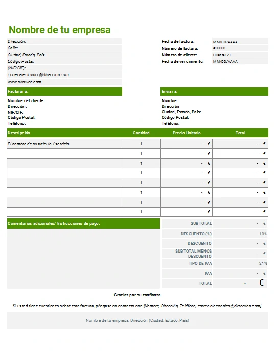

1. En Word, deberíamos escribir los artículos, la cantidad, el precio unitario y NOSOTROS tener que calcular el precio total de ese artículo
2. Repetir el proceso con todos los artículos.
3. Después sumar el total de todos los artículos para calcular el subtotal. 
4. Después calcular el descuento.
5. Después restar el descuento al subtotal.
6. Después calcular el IVA sobre el subtotal.
7. Después sumar el IVA al subtotal.
8. Y mostrar ese cálculo como el total de la factura.

Lo más guay de todo, es que si una vez que hemos terminado, **añadimos un nuevo artículo**, deberíamos de volver a **CALCULARLO TODO DE NUEVO** 😫.

En cambio, si lo hacemos en Excel, en cada celda calculada, tan solo debemos decirle a Excel como se ha calculado y lo calculará por nosotros. Y si cambiamos cualquier valor, se volverá a **RECALCULAR TODO** automáticamente ✨. Y podremos **reusar el libro** para generar más facturas 🥰.

🟩 **Para lo que no:** Para hacer una tabla estática. Por ejemplo, un horario de clase. Excel es para información dinámica (que cambia, se calcula y se vuelve a recalcular). Para información estática, mejor hacer un documento en Word.

> [!CAUTION]
>
> Por supuesto puede haber excepciones, se pueden hacer facturas en Word y un cartel muy chulo en Excel. No todo es blanco o negro. También se pueden incrustar tablas de Excel en Word y hacer fórmulas en Word. Pero lo normal es **datos dinámicos en Excel** e **información estática en Word**.

---

# Fórmulas

Una fórmula es una secuencia formada por: valores constantes, referencias a otras celdas, nombres, funciones u operadores. 

Se pueden realizar diversas operaciones con los datos de las hojas de cálculo como `+`, `-`, `*`, `/`, `Sen`, `Cos`, etc. 

> [!important] 
>
> La fórmula se escribe en la barra de fórmulas o en el contenido de la celda y debe **empezar siempre por el signo igual `=`**.

**Ejemplo de fórmula**
$$
=3+1
$$

- En ésta formula, hay un valor constante `3`, un operador `+` y otro valor constante que es `1`. Por lo que al resolver la fórmula, el resultado final es `4`.
- En la celda se sustituye la fórmula por el resultado de la misma, por lo que se mostrará un `4`. 
- Si haces clic izquierdo con el ratón sobre una celda, se quedará seleccionada y como **contenido de la celda verás el resultado** de ejecutar la fórmula, mientras que en **barra de fórmulas verás su fórmula**.
- Si haces doble clic sobre una celda, entras en modo edición, desaparece el resultado, aparece la fórmula y puedes modificarla. Al pulsar <kbd>Intro</kbd> se valida la fórmula y si es correcta, volverá a aparecer el resultado.

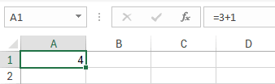{.rounded-2}

## Tipos de operadores

En una fórmula podemos encontrarnos varios operadores, veamos los tipos de operadores que existen en Excel.

🟩 **Aritméticos:** se emplean para producir resultados numéricos. 

| Operador | Descripción    | Ejemplo                                                |
| :------- | :------------- | :----------------------------------------------------- |
| `+`      | Suma           | `=A1 + B1`                                             |
| `-`      | Resta          | `=A1 - B1`                                             |
| `*`      | Multiplicación | `=A1 * B1`                                             |
| `/`      | División       | `=A1 / B1`                                             |
| `%`      | Porcentaje     | `=A1 * 10%` o bien `=A1 * 0.1`  (calcula el 10% de A1) |
| `^`      | Exponenciación | `=A1^2` (eleva A1 al cuadrado)                         |

🟩**Lógicos:** se emplean para producir resultados lógicos (verdadero o falso).

| Operador | Descripción       | Ejemplo                                                      |
| :------- | :---------------- | :----------------------------------------------------------- |
| `=`      | Igual a           | `=A1 = B1` (verdadero si A1 es igual a B1)                   |
| `<>`     | Diferente de      | `=A1 <> B1` (verdadero si A1 no es igual a B1)               |
| `>`      | Mayor que         | `=A1 > B1` (verdadero si A1 es mayor que B1)                 |
| `<`      | Menor que         | `=A1 < B1` (verdadero si A1 es menor que B1)                 |
| `>=`     | Mayor o igual que | `=A1 >= B1` (verdadero si A1 es mayor o igual que B1) `= A >= A` |
| `<=`     | Menor o igual que | `=A1 <= B1` (verdadero si A1 es menor o igual que B1)        |
| `AND`    | Y lógico          | `=AND(A1>5, B1<10)` (verdadero si A1 es mayor que 5 y B1 es menor que 10) |
| `OR`     | O lógico          | `=OR(A1>5, B1<10)` (verdadero si A1 es mayor que 5 o B1 es menor que 10) |
| `NOT`    | Negación lógica   | `=NOT(A1>5)` (verdadero si A1 no es mayor que 5)             |

🟩**Operadores de texto:** Para concatenar (pegar) dos valores de texto:

| Operador | Descripción            | Ejemplo                                        |
| :------- | :--------------------- | :--------------------------------------------- |
| `&`      | Concatenación de texto | `="Hola" & " mundo"` (resulta en “Hola mundo”) |

🟩**Operadores de rango:** Para referenciar un rango de celdas:

| Operador | Descripción     | Ejemplo                                                      |
| :------- | :-------------- | :----------------------------------------------------------- |
| `:`      | Rango de celdas | `=B1:B8` Referencia todas celdas comprendidas desde `B1` hasta `B8` |

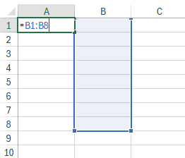{.rounded-2}

## Prioridad

Cuando hay **varias operaciones en una misma expresión**, cada parte de la misma se evalúa y se resuelve en un orden determinado. Ese orden se conoce como **prioridad de los operadores**.

Se pueden **utilizar paréntesis para modificar el orden de prioridad** y forzar la resolución de algunas partes de una expresión antes que otras.

Las operaciones entre paréntesis son siempre ejecutadas antes que las que están fuera del paréntesis. Sin embargo, dentro de los paréntesis se mantiene la prioridad normal de los operadores.

Cuando hay expresiones que contienen operadores de más de una categoría, **se resuelve antes** las que tienen **operadores aritméticos**, **a continuación** las que tienen **operadores de comparación** y **por último** las de **operadores lógicos** .

Los operadores aritméticos siguen las mismas reglas que en matemáticas, que básicamente son:

1. **Paréntesis:** Excel evalúa las expresiones dentro de los paréntesis primero.
2. **Exponentes:** Luego, calcula cualquier operación de exponente en la expresión.
3. **Multiplicación y División:** Realiza las operaciones de multiplicación y división de izquierda a derecha.
4. **Suma y Resta:** Finalmente, realiza las operaciones de suma y resta de izquierda a derecha.

> [!TIP]
>
> 🤓Para no tener que recordar el orden de prioridad de ningún operador, usa los paréntesis `(` `).` Además de forzar la prioridad como tu quieras, mejorarás la legibilidad de la fórmula y dejas claro el orden en el que quieres que se ejecute algo. **Son gratis y todo ventajas**.
> $$
> PrecioTotal = PrecioUnitario * Cantidad  + Impuestos
> $$
>
> $$
> PrecioTotal = (PrecioUnitario * Cantidad)  + Impuestos
> $$
>
> En este ejemplo, los paréntesis indican claramente que primero debemos multiplicar el precio unitario por la cantidad y luego sumar los impuestos. 
>
> **No son obligatorios, pero hace que la fórmula sea más fácil de entender** y reduce la posibilidad de errores al escribir o leer.

## Errores en las fórmulas

Cuando introducimos una fórmula en una celda puede ocurrir que se produzca un **error**. Dependiendo del tipo de error puede que Excel nos avise o no.

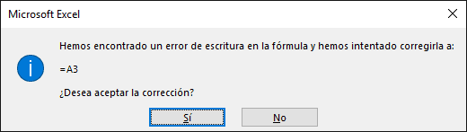{.rounded-2}

Nos da una posible propuesta que podemos aceptar haciendo clic sobre el botón **Sí** o rechazar utilizando el botón **No**.

A veces no saldrá ninguna ventana, si no que en el contenido de la celda aparecerá lo siguiente:

| Error        | Descripción                                                  |
| :----------- | :----------------------------------------------------------- |
| **#DIV/0!**  | Aparece cuando una fórmula intenta dividir por cero o por un valor equivalente a cero. Por ejemplo, si una celda está en blanco o no contiene datos, se evalúa como cero y puede generar este error. |
| **#NOMBRE?** | Indica que Excel no reconoce algo en la fórmula. Puede ser un nombre de función mal escrito, un rango con nombre inexistente o una referencia de celda incorrecta. |
| **#N/A**     | Aparece cuando no se encuentra un valor buscado en una función de búsqueda o coincidencia. Por ejemplo, si usas `BUSCARV` y no encuentra el valor buscado en la tabla, se muestra este error. |
| **#NUM!**    | Ocurre cuando hay un problema numérico, como una raíz cuadrada negativa o un argumento no válido en una función matemática. |
| **#VALOR!**  | Se muestra cuando hay un tipo de dato incorrecto en la fórmula. Por ejemplo, si intentas sumar texto con números, puede aparecer este error. |
| **#REF!**    | Indica una referencia de celda inválida, como cuando borras una celda a la que se hace referencia en otra fórmula. |
| **####**     | Este error se muestra cuando la columna es demasiado estrecha para mostrar el valor numérico correctamente. |

> [!NOTE] 
>
> También en estos casos, la celda contendrá además un símbolo en la esquina superior izquierda tal como: {.img-inline}.
> 

## 👨‍🏫Ejercicio 2

1. Crea un libro nuevo.

2. Haremos la tabla de multiplicar del 1. Algo parecido a lo siguiente:

   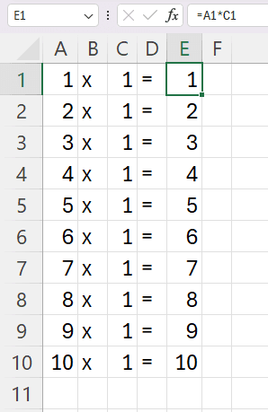

3. En la última columna incluiremos una fórmula para calcular el resultado de multiplicar el primer número por el segundo.

4. Ya tenemos nuestra tabla del 1 terminada. ¿Y si queremos hacer ahora la tabla del 4? ¿Tenemos que cambiar bastantes cosas verdad? Vamos a arreglarlo.

5. Le vamos a incluir en una celda cualquiera el número del que queremos su tabla de multiplicar. En el ejemplo la hemos puesto en `G2`.

   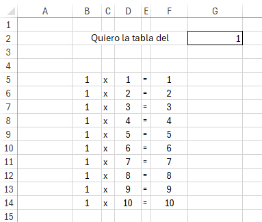{.rounded-2}

6. Sustituiremos todas las constantes de la columna `B` (el valor 1) por el valor que haya en la celda `G2`, usando una fórmula.

7. Prueba a cambiar el valor de `G2` y se deberían de recalcular todos los valores de la columna `F`.

8. Guarda el libro como "`Ejercicio 2 - Multiplicar`" y cierra Excel.

> [!TIP]
>
> 🔮 ¿Sabías que Excel es muy listo y puede "intuir " lo que quieres hacer en las siguientes celdas? Es un buen momento para aprender un nuevo truco ✨

---

## Extender

### Completar la serie

Si en las celdas a copiar no hay fórmulas sino **valores constantes** como fechas o series de números, Excel rellenará las nuevas celdas continuando la serie.

Por ejemplo: 

- Si extendemos los valores `1`, `2`, `3`, nos generará `4`, `5`, `6`, `7`, `8`, `9`, `10`, etc. 
- Si extendemos los valores `0`, `5`, `10`, nos generará `15`, `20`, `25`, `30`, `35`, etc.
- Si extendemos los valores `4`, `3`, `2`, nos generará, `1`, `0`, `-1`, `-2`, `-3`, etc.
- Si extendemos los valores `Lunes`, `Martes`, `Miércoles`, nos generará `Jueves`, `Viernes`, `Sábado`, etc.
- Si extendemos los valores `14:00`, `14:30`, nos generará `15:00`, `15:30`, `16:00`, `16:30`, etc.
- ¿Lo vamos pillando verdad? 😅

### Extender fórmulas

Aunque lo anterior mola, es mucho más útil **extender una fórmula a otras celdas**. Extender fórmulas en Excel es una habilidad esencial para trabajar eficientemente con hojas de cálculo. Aquí tienes una guía paso a paso de como hacerlo:

1. **Selecciona la celda con la fórmula o el dato a extender**:
   - Haz clic en la celda que contiene la fórmula que deseas extender.
2. **Ubica el punto de relleno**:
   - En la esquina inferior derecha de la celda seleccionada, verás un pequeño cuadrado llamado “punto de relleno”.  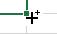{.img-inline}
   - Este punto de relleno te permite copiar y extender la fórmula.
3. **Arrastra el punto de relleno hacia el rango deseado**:
   - Haz clic en el punto de relleno y arrástralo hacia abajo (o hacia la derecha) para extender la fórmula a las celdas adyacentes.
   - Excel automáticamente ajustará las referencias celulares en la fórmula para que se apliquen correctamente a las nuevas celdas.
4. **Suelta el clic del ratón para completar la extensión**:
   - Una vez que hayas arrastrado el punto de relleno al rango deseado, suelta el clic del ratón.
   - La fórmula se extenderá a todas las celdas en ese rango.

Recuerda verificar que la fórmula sea precisa antes de extenderla. Siempre es buena práctica revisar dos veces para evitar errores.

> [!WARNING]
>
> Por defecto, el punto de relleno está activado, pero si no aparece podemos activarlo entrando en el menú **Archivo**, **Opciones** y, en la ficha **Avanzadas,** activando la casilla **Permitir arrastrar y colocar el controlador de relleno y las celdas**.

Cuando **copiamos celdas con fórmulas que contienen referencias a otras celdas**, como por ejemplo **=A2+3**, **la fórmula variará,** dependiendo de donde vayamos a copiar la fórmula. Esto es porque las referencias contenidas en la fórmula son lo que denominamos **REFERENCIAS RELATIVAS:** son relativas a la celda que las contiene.

Así, si en la celda **`B3`** tenemos la fórmula **`=A2+3`** y copiamos la celda **`B3`** a la celda **`B4`** , esta última contendrá la fórmula **`=A3+3`.** A veces puede resultar incómodo la actualización anterior a la hora de trabajar y por ello Excel dispone de otros tipos de referencias como son las **ABSOLUTAS** y las **MIXTAS**.

🟩**Referencias Absolutas**: Se utilizan para hacer referencia a una celda o rango específico en una hoja de cálculo.
- Estas referencias **no cambian** cuando copias o arrastras una fórmula a otras celdas.
- Para crear una referencia absoluta, se coloca un signo de dólar (`$`) antes de la letra de la columna y el número de fila. Por ejemplo, si deseas hacer referencia a la celda `B2`, la referencia absoluta sería `$B$2`.
- Las referencias absolutas son útiles cuando necesitas que una celda o rango mantenga siempre su valor, como tasas de impuestos o valores constantes.

🟩**Referencias Mixtas**: Combinan características de las referencias relativas y absolutas.

- Puedes ajustar solo una parte de la referencia (o filas o columnas) al copiar o mover la fórmula.
- Hay dos tipos de referencias mixtas:
  - **Columna absoluta y fila relativa**: Se indica con un signo de dólar (`$`) antes de la letra de la columna, pero no antes del número de fila (por ejemplo, `$C25`).
  - **Fila absoluta y columna relativa**: Se indica con un signo de dólar (`$`) antes del número de fila, pero no antes de la letra de la columna (por ejemplo, `A$14`).
- Las referencias mixtas son útiles cuando deseas que una parte de la referencia se ajuste automáticamente y otra parte permanezca fija.

> [!NOTE]
>
> **Recuerda:** Las referencias absolutas no cambian su ubicación al copiar o arrastrar una fórmula, mientras que las referencias mixtas permiten ajustar solo una parte de la referencia.

---

# Funciones

En matemáticas, una función toma un valor (o conjunto de valores) como entrada y produce un valor único como salida. Por ejemplo:
$$
f(x) = x^2+1
$$

$$
f(3) = 3^2+1 = 10
$$

$$
f(4) = 4^2+1 = 17
$$

En Excel, una **función** es una fórmula predefinida que realiza cálculos específicos utilizando valores llamados **argumentos**. Estas funciones pueden ser simples o complejas y se utilizan para realizar tareas como sumar, promediar, buscar, contar, entre otras.

Normalmente una función **recibe argumentos** (o puede que no) y **siempre devuelve un valor**. Ese valor puede ser numérico, fechas, texto, lógico, etc. 

**Por ejemplo:**
$$
=SUMA(A1:C7)
$$
Tenemos la función `SUMA()` que devuelve como resultado la suma de sus argumentos. El operador "**:**" nos **identifica un rango de celdas**. Así **`A1:C7`** indica todas las celdas incluidas entre la celda `A1` y la `C7`. De esta manera, la función anterior sería equivalente a:
$$
=A1 + A2 + A3 + A4 + A5 + A6 + A7 + B1 + B2 + B3+ B4 + B5 + B6 + B7 + C1 + C2 + C3+ C4 + C5 + C6 + C7
$$
En este ejemplo, se puede apreciar la ventaja de utilizar la función.

Excel incluye **más de 350 funciones** integradas que abarcan una amplia variedad de tareas. Estas funciones te permiten realizar cálculos, análisis de datos, manipulación de texto, fechas y más. 

Puedes encontrarlas agrupados por categorías en la pestaña **`Fórmulas` > `Biblioteca de funciones`**.

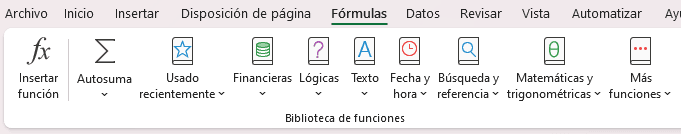{.rounded-2}

Por razones obvias no las veremos todas 🤯. Algunas de las funciones más utilizadas son:

### Básicas matemáticas

- **SUMA**:
  - Suma los valores de un rango de celdas.
  - Ejemplo: `=SUMA(A1:A5)` suma los valores en las celdas A1 a A5.
- **PROMEDIO**:
  - Calcula el promedio de un rango de celdas.
  - Ejemplo: `=PROMEDIO(B1:B10)` calcula el promedio de los valores en las celdas B1 a B10.
- **CONTAR**:
  - Cuenta el número de celdas que contienen valores numéricos en un rango.
  - Ejemplo: `=CONTAR(C1:C20)` cuenta cuántas celdas **no vacías** hay en C1 a C20.
- **MAX**:
  - Encuentra el valor máximo en un rango de celdas.
  - Ejemplo: `=MAX(D1:D15)` devuelve el valor máximo en las celdas D1 a D15.
- **MIN**:
  - Encuentra el valor mínimo en un rango de celdas.
  - Ejemplo: `=MIN(E1:E8)` devuelve el valor mínimo en las celdas E1 a E8.
- **ALEATORIO.ENTRE**:
  - Devuelve un número entero aleatorio entre los números que especifique.
  - Ejemplo: `=ALEATORIO.ENTRE(1;6)` devuelve un número aleatorio entre 1 y 6, ambos inclusive.

### Fecha y hora

- **FECHA**:
  - Obtiene el valor de la fecha utilizando los valores de año, mes y día como argumentos. Es decir, convierte 3 números enteros en una fecha.
  - Ejemplo: `=FECHA(2024; 5; 10)` devuelve la fecha 10 de mayo de 2024.
- **HOY**:
  - Obtiene la fecha actual.
  - Ejemplo: `=HOY()` devuelve la fecha actual.
- **DIA**:
  - Obtiene el valor del día (1 a 31) a partir de una fecha específica.
  - Ejemplo: `=DIA(F1)` devuelve el día correspondiente a la fecha en la celda F1.
- **HORA**:
  - Obtiene un valor entero de una hora indicada (0 a 23).
  - Ejemplo: `=HORA(G1)` devuelve la hora de la celda G1.
- **DIASEM**:
  - Obtiene el día de la semana como un número para una fecha especificada (1 a 7). El 1 representa el domingo y el sábado el 7.
  - Ejemplo: `=DIASEM(H1)` devuelve el día de la semana para la fecha en la celda H1.

> [!TIP]
>
> Puedes combinar funciones y anidarlas para realizar cálculos más avanzados. Una función retorna un valor que sirve como argumento a otra función.
> $$
> =SUMA(ABS(A1:A3))
> $$
>
> - La función **ABS** toma cada número en el rango y devuelve su valor absoluto.
> - La función **SUMA** luego suma los valores absolutos resultantes.
> - Si tenemos los valores `4`, `5` y `-4` en el rango `A1:A3`, la suma absoluta daría `13`. Si no daría `5`.

> [!IMPORTANT]
>
> Todas las funciones tienen que seguir una sintaxis y si ésta no se respeta Excel nos mostrará un mensaje de error.
>
> 1. Los **argumentos** o valores de entrada van siempre **entre paréntesis**. No dejes espacios antes o después de cada paréntesis.
> 2. Los **argumentos pueden ser** valores **constantes** (número o texto), referencias a otras celdas, **fórmulas** u **otras funciones**.
> 3. Los **argumentos** deben **separarse** por un punto y coma **`;`**.

### 👩‍🏫Ejercicio 3

Usaremos funciones de aquí en adelante en todos los ejercicios, pero para ir acostumbrándonos a su uso haremos un ejercicio práctico:

Supongamos que tenemos una lista de calificaciones de estudiantes en las celdas A1 a A5, y queremos calcular algunos resultados utilizando funciones. A continuación, se presenta la tabla de datos:

| Estudiante | Calificación |
| :--------- | :----------- |
| Emma       | 85           |
| Liam       | 60           |
| Olivia     | 75           |
| Noah       | 90           |
| Pedro      | 55           |

Una vez terminada vamos a añadirle la siguiente información:

1. **Número total de estudiantes**:
   - Utiliza la función **CONTAR** para contar cuántos estudiantes hay en la lista.
2. **Promedio de calificaciones**:
   - Utiliza la función **PROMEDIO** para calcular la calificación promedio de los estudiantes.
3. **Calificación más alta**:
   - Utiliza la función **MAX** para encontrar la calificación más alta.
4. **Calificación más baja**:
   - Utiliza la función **MIN** para encontrar la calificación más baja.
5. **Suma de todas las calificaciones**:
   - Utiliza la función **SUMA** para obtener la suma total de las calificaciones.

Tienes libertad sobre dónde mostrar dicha información. Pero hazlo usando funciones, no haciendo las comprobaciones manualmente 🙈.

Puedes guardarlo con el nombre de `Ejercicio 3 - Funciones`.

---

### Errores con las funciones

Podemos controlar los errores en las fórmulas. Para corregirlos, necesitaremos, primero, localizarlos.

Por ejemplo, al introducir una fórmula manualmente podemos cometer un error sintáctico como **`=PROMEDO(A1:A9)`**, lo que provocaría que apareciese en la celda un error de tipo **`#¿NOMBRE?`**.

Si pulsamos sobre la pestaña **`Fórmulas`** > **`Auditoría de fórmulas`** > **`Comprobación de errores...`** 

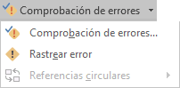

Aparece el cuadro de diálogo **Comprobaciones de errores** como el que vemos en la imagen donde nos informa del tipo de error que se ha detectado y, en ocasiones, nos ofrece una corrección.

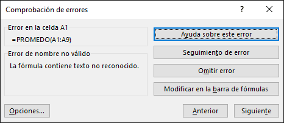{.rounded-4}

La parte más interesante es la descripción del error. Lo normal es que con ella sepamos cuál es el problema y, pulsando **Modificar en la barra de fórmulas**, la rectifiquemos manualmente.

Con los botones **Anterior** y **Siguiente** podremos ir moviéndonos entre los errores del libro, si es que hay más de uno.

Además, disponemos de herramientas útiles como la **Ayuda sobre este error**, u **Omitir error**, para dejar la fórmula tal y como está.

---

# Validación de datos

La validación de datos nos permite asegurarnos de que los valores que se introducen en las celdas son los adecuados, pudiendo incluso mostrar un mensaje de error o aviso si nos equivocamos.

Para **aplicar una validación a una celda.**

- Seleccionamos la celda que queremos validar.
- Accedemos a la pestaña **`Datos`** > **`Herramientas de datos`** > **`Validación de datos`**.

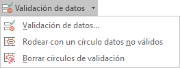

Nos aparece un cuadro de diálogo **Validación de datos** como el que vemos en la imagen donde podemos elegir entre varios tipos de validaciones.

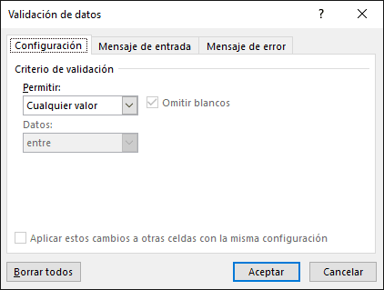{.rounded-4}

En la sección **Criterio de validación** indicamos la condición para que el dato sea correcto.

Dentro de **Permitir** podemos encontrar **Cualquier valor, Número entero**, **Decimal**, **Lista**, **Fecha**, **Hora**, **Longitud del texto** y **Personalizada**. Por ejemplo, si elegimos **Número entero**, Excel sólo permitirá números enteros en esa celda: si el usuario intenta escribir un número decimal, aparecerá un mensaje de error.

Podemos restringir más los valores permitidos en la celda con la opción **Datos**, donde, por ejemplo, podemos indicar que los valores estén entre **2** y **8**.

Si en la opción **Permitir:** elegimos **Lista,** podremos escribir una **lista de valores** para que el usuario pueda escoger un valor de los disponibles en la lista. En el recuadro que aparecerá, **Origen:** podremos escribir los distintos valores separados por ; (punto y coma) para que aparezcan en forma de lista.

En la pestaña **Mensaje de entrada** podemos introducir un mensaje que se muestre al acceder a la celda. Este mensaje sirve para informar de qué tipos de datos son considerados válidos para esa celda.

En la pestaña **Mensaje de error** podemos escribir el mensaje de error que queremos que se le muestre al usuario cuando introduzca en la celda un valor incorrecto.

> [!TIP]
>
> También podemos limitar los valores de una celda a un rango de valores previamente establecidos, de forma que al introducir los valores me sale un desplegable con valores para elegir.
>
> 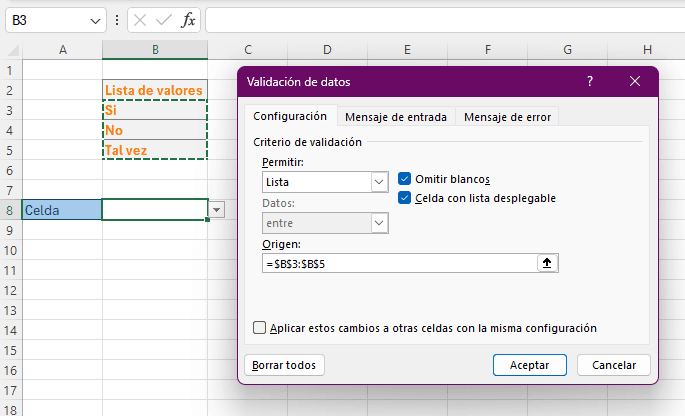{.rounded-4}
>
> 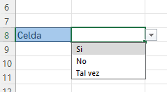{.rounded-2}

## 👨‍🏫Ejercicio 4

1. Crea una copia del ejercicio de la tabla de multiplicar. Llámalo `Ejercicio 4 - Validación`. 
2. Crea una regla de validación para la casilla dónde introducimos el número de la tabla que queremos calcular. 
   1. Se permiten solo números, comprendidos entre el 0 y el 10.
   2. Añade un mensaje para la entrada de datos, los que veas oportunos.
   3. Añade un mensaje de error personalizado para informar al usuario cuando no se cumplan las reglas.

---

# Formato de celdas y estilos

## Formato

Excel nos permite **modificar la visualización de los valores en una celda**, mejorando la legibilidad de los datos sin cambiar el contenido.

Por ejemplo, yo quiero guardar una cantidad que representa dinero, pues puedo guardar en una celda el valor `1234`, pero al visualizarlo, me muestra `1.234,00 €`. 

🟩**Veamos los distintos tipos de formatos que hay:**

En la pestaña `Inicio` > `Número`, pulsamos sobre el desplegable de `General`.

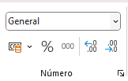{.rounded-2}

Al abrir el desplegable, se mostrarán las distintos formatos para los datos más comunes:

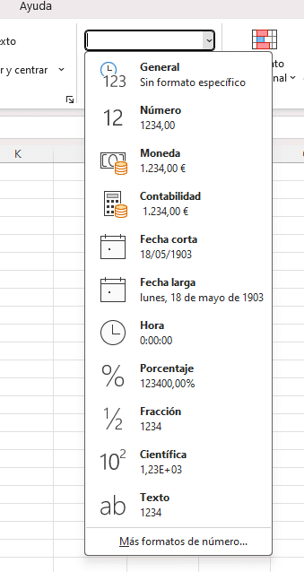{.rounded-4}

Si pulsamos en **Más formatos de número...**, aparecerá una ventana como la siguiente para obtener más opciones sobre cada formato o bien crear nuestros propios formatos personalizados.

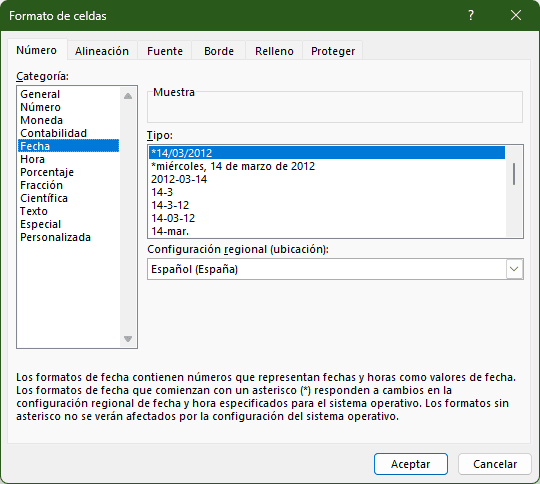{.rounded-4}

> [!NOTE]
>
> Por ejemplo, aquí se puede ver que para el formato **Fecha**, podemos elegir hasta un total de 18 formatos predefinidos.

🟩**Para aplicar los formatos:** Hay que seleccionar la celda o rango de celdas que queramos aplicar el formato, y después seleccionar del desplegable de `Inicio` > `Número` para aplicar el formato.

## 👩‍🏫Ejercicio 5

Tenemos los siguientes datos:

| Fecha Ingreso | Nombre Empleado  | Sueldo Base (€) | Horas Extras | Ventas (€) | Comisión (%) |
| :------------ | :--------------- | :-------------- | :----------- | :--------- | :----------- |
| 15/05/2019    | Ana Pérez        | 2500            | 10           | 8000       | 15           |
| 10/03/2017    | Juan López       | 2800            | 5            | 6000       | 12           |
| 20/08/2022    | María García     | 2300            | 8            | 4500       | 18           |
| 05/11/2018    | Pedro Martínez   | 2600            | 12           | 7000       | 20           |
| 29/04/2023    | Sagrario Alameda | 1800            | 0            | 0          | 15           |

Sabiendo que:

- El precio por hora extra se calcula dividiendo el sueldo base entre 100. Ejemplo: Si cobras 1500€ de sueldo base, la hora extra la cobras a 15€.
- El sueldo total de cada empleado es la suma de su sueldo base + el sueldo de sus horas extras + la comisión de sus ventas.

Haz los siguientes cambios:

1. Añadir las siguientes columnas al final de la tabla:
   1. **Sueldo Hora Extra:** Se calculará la cantidad que ha ganado el empleado en horas extras este mes. Ten en cuenta lo descrito anteriormente.
   
   2. **Sueldo Comisión:** Se calculará la comisión que ha ganado el empleado por sus ventas. Es el porcentaje de su comisión por sus ventas.
   
   3. **Antigüedad**: Se mostrará el número de **años** que lleva el empleado en la empresa. 
   
      > [!tip]
      >
      > Tendrás que investigar alguna función de fechas para hacer el cálculo.
   
   4. **Sueldo Total:** Es la suma del sueldo base, el sueldo de horas extras y el sueldo de la comisión.
   
2. Cambia el formato de las siguientes celdas:
   1. **Fecha ingreso:** El formato de la fecha deberá ser `2024-abr-29`. Es decir, primero el año con 4 dígitos, después una abreviatura del mes y después el día con dos dígitos. 
   
      > [!tip]
      >
      > Busca entre los formatos personalizados de fechas.
   
   2. Todas las **columnas de cantidades en euros**, ponle formato moneda en euros, con dos decimales.
   
   3. La cantidad de años, deberá ser un número decimal con 3 decimales.
   
3. Alinea las celdas de la siguiente forma:
   1. Textos y fechas a la izquierda
   2. Números a la derecha.
   
4. Guarda el libro con el nombre de `Ejercicio 5 - Sueldos.xlsx` y cierra Excel.

---

## Formato condicional

El formato condicional sirve para que, dependiendo del valor de la celda, Excel aplique un formato especial o no sobre esa celda.

El formato condicional suele utilizarse para resaltar errores, para valores que cumplan una determinada condición, para resaltar las celdas según el valor contenido en ella, etc.

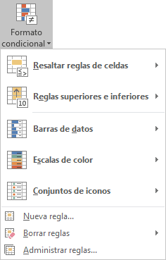

Cómo **aplicar un formato condicional** a una celda:

1. Seleccionamos la celda a la que vamos a aplicar un formato condicional.
2. Accedemos a la pestaña **`Inicio`** > **`Estilos`** > **`Formato condicional`**.

Aquí tenemos varias opciones, como resaltar algunas celdas dependiendo de su relación con otras, o resaltar aquellas celdas que tengan un valor mayor o menor que otro.

Nosotros nos fijaremos en la opción **Nueva regla** que permite crear una regla personalizada para aplicar un formato concreto a aquellas celdas que cumplan determinadas condiciones. **Controlando esta opción, controlaremos todas.**

Nos aparece un cuadro de diálogo **Nueva regla de formato** como el que vemos en la imagen.

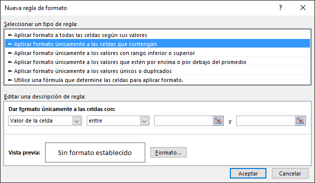{.rounded-4}

En este cuadro seleccionaremos un tipo de regla. Normalmente querremos que se **aplique el formato únicamente a las celdas que contengan** un valor, aunque puedes escoger otro diferente.

En el marco **Editar una descripción de regla** deberemos indicar las condiciones que debe cumplir la celda y de qué forma se marcará.

De esta forma, si nos basamos en el **Valor de la celda** podemos escoger entre varias opciones como pueden ser un valor entre un rango mínimo y máximo, un valor mayor que, un valor menor que y condiciones de ese estilo.

Los valores de las condiciones pueden ser valores fijos o celdas que contengan el valor a comparar.

Si pulsamos sobre el botón **Formato...** entramos en un cuadro de diálogo donde podemos escoger el formato con el que se mostrará la celda cuando la condición se cumpla. El formato puede modificar, el color de la fuente de la letra, el estilo, el borde de la celda, el color de fondo de la celda, etc.

Al pulsar sobre **Aceptar** se creará la regla y cada celda que cumpla las condiciones se marcará. Si el valor incluido en la celda no cumple ninguna de las condiciones, no se le aplicará ningún formato especial.

Si pulsamos sobre **Cancelar**, no se aplicarán los cambios efectuados en el formato condicional.

🟩**Ejemplo:** Queremos aplicar un formato condicional a la tabla anterior, para que:

- Los empleados con unas ventas inferiores o iguales a 5.000€, se muestren en amarillo (como el estilo neutral)
- Las superiores a 5.000€ se muestren en verde (como el estilo bueno).
- Las inferiores a 1.000€ se muestren en rojo (como el estilo incorrecto).

1. Seleccionamos la columna de ventas.

2. Pulsamos en **Formato Condicional** > **Nueva regla**.

3. Seleccionamos la opción **`Aplicar formato únicamente a las celdas que contengan...`**

4. Valor de la celda menor o igual a 5000, pulsamos formato y elegimos un formato amarillo.

   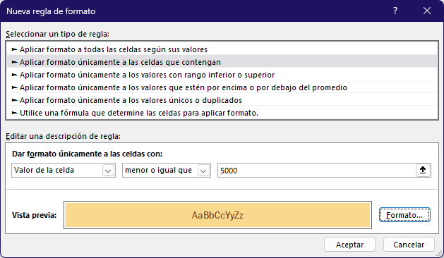{.rounded-4}

5. Pulsamos `Aceptar`, y comprobamos que se han aplicado correctamente los estilos de acuerdo a la regla.

   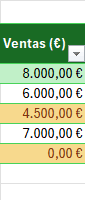{.rounded-2}

6. Repetimos el procedimiento para añadir la siguiente regla (mayores de 5.000€).

7. Repetimos el procedimiento para añadir la siguiente regla (menores de 1.000€).

8. Comprobamos que se muestra todo correcto.

   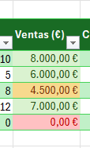{.rounded-2}

> [!TIP]
>
> Si queremos modificar las reglas existentes, seleccionamos el rango, `Inicio` > `Formato Condicional` > `Administrar reglas`. Nos saldrá una ventana como la siguiente:
>
> 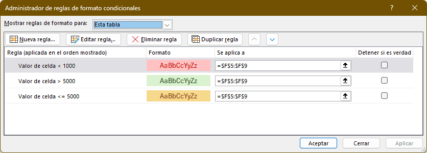{.rounded-4}
>
> Ahí veremos todas las reglas aplicadas y podemos hacer doble clic sobre la que queramos para modificarla. Desde ahí también podemos crear una nueva, editarlas, eliminarlas y duplicarlas.

## 👩‍🏫Ejercicio 6

Haz una copia del ejercicio 5 y llámalo `Ejercicio 6 - Formato condicional`. Aplícale formatos condicionales a la columna de las horas extras. 

- Un estilo para los que hayan trabajado 10 o más horas extras.
- Un estilo para los que hayan trabajado entre 5 y 9 horas extras.
- Un estilo para los que hayan trabajado entre 1 y 4 horas extras.
- Un estilo para los que no hayan trabajado ninguna hora extra.

Tienes libertad creativa, tu elige los estilos que prefieras 👩‍🎨.

> [!TIP]
>
> Añade nuevas filas a la tabla para comprobar que todos los estilos se muestran correctamente.

---

## Temas

Un tema es un conjunto de **formatos que conforman el estilo general que presenta un libro**. Engloba los colores, la fuente y los distintos efectos que utilizará por defecto del documento al completo. Ésto no implica que no se puedan personalizar las celdas de forma independiente, como hemos aprendido anteriormente, pero sí deberemos tener en cuenta que, si utilizamos **colores del tema** al colorear un relleno o un texto, éstos cambiarán si modificamos el tema.

Para cambiar el tema nos situaremos en la pestaña **Disposición de página**, en la sección **Temas**.

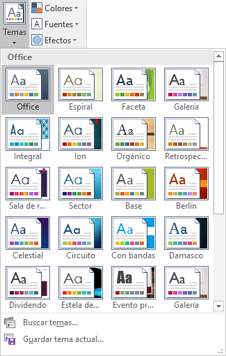

Esto ya lo vimos en Word, por lo que sólo lo nombramos para que sepas que sigue ahí y porque sabemos que a todo el mundo le gusta cambiar colorines 😘.

---

# Tablas

En Excel también podemos crear tablas igual que en Word. Aunque TODO Excel parezca una tabla, podemos delimitar ciertos valores para darles formato de tabla.

Veremos como **dar formato como tabla** a unos valores ya existentes y también veremos como **crear una tabla** sin valores previos.

## Dar formato como tabla (recomendado)

Es más sencillo añadir los valores directamente en unos rangos de celdas para posteriormente convertirlos a tabla. Vamos a ver los pasos:

Supongamos que tenemos los siguientes datos:

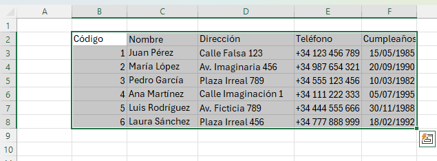{.rounded-4}

    
📋Puedes copiar y pegar de aquí

    <table>
        <thead>
            <tr>
                <th>Código</th>
                <th>Nombre</th>
                <th>Dirección</th>
                <th>Teléfono</th>
                <th>Cumpleaños</th>
            </tr>
        </thead>
        <tbody>
            <tr>
                <td>1</td>
                <td>Juan Pérez</td>
                <td>Calle Falsa 123</td>
                <td>+34 123 456 789</td>
                <td>15/05/1985</td>
            </tr>
            <tr>
                <td>2</td>
                <td>María López</td>
                <td>Av. Imaginaria 456</td>
                <td>+34 987 654 321</td>
                <td>20/09/1990</td>
            </tr>
            <tr>
                <td>3</td>
                <td>Pedro García</td>
                <td>Plaza Irreal 789</td>
                <td>+34 555 123 456</td>
                <td>10/03/1982</td>
            </tr>
            <tr>
                <td>4</td>
                <td>Ana Martínez</td>
                <td>Calle Imaginación 1</td>
                <td>+34 111 222 333</td>
                <td>05/07/1995</td>
            </tr>
            <tr>
                <td>5</td>
                <td>Luis Rodríguez</td>
                <td>Av. Ficticia 789</td>
                <td>+34 444 555 666</td>
                <td>30/11/1988</td>
            </tr>
            <tr>
                <td>6</td>
                <td>Laura Sánchez</td>
                <td>Plaza Irreal 456</td>
                <td>+34 777 888 999</td>
                <td>18/02/1992</td>
            </tr>
        </tbody>
    </table>

1. Seleccionamos los datos (rango `B2:F8`).

2. Pulsamos `Inicio` > `Estilos` > `Dar formato como tabla`

3. Se desplegará la lista de estilos de tablas y seleccionamos el que queramos. También podrás volver a modificarlo más adelante si no te convence el que elijas ahora.

   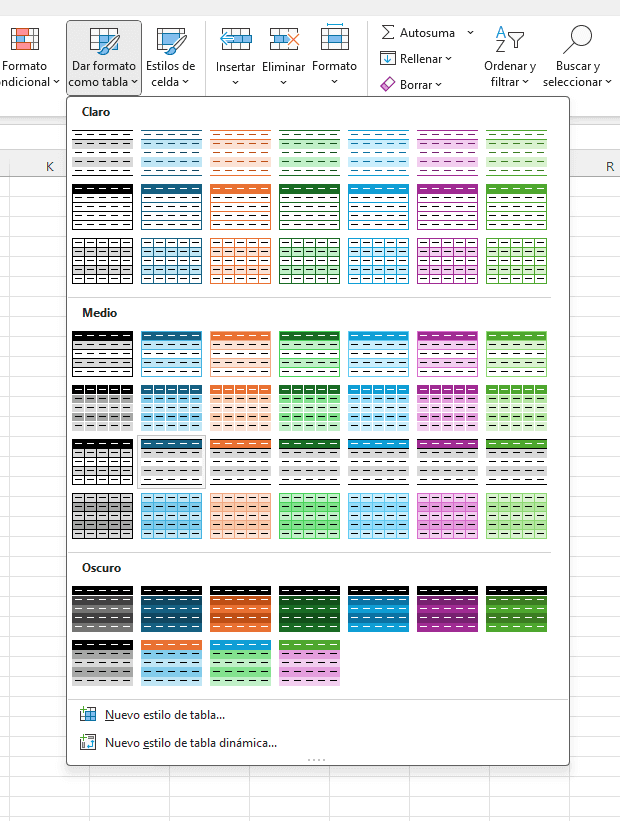{.rounded-4}

4. Nos saldrá la siguiente ventana:

   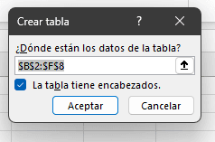{.rounded-4}

5. Ahí nos preguntará el rango donde se encuentran los datos y se mostrará automáticamente el rango que seleccionamos en el paso 1 (si no lo hicimos, ahora podemos hacerlo). Como también le incluimos los encabezados en la selección, le dejamos marcada la opción de `La tabla tiene encabezados`.

6. Y ya nos mostrará la tabla formateada, con opciones en las columnas para **reordenar**, **filtrar**, etc.

   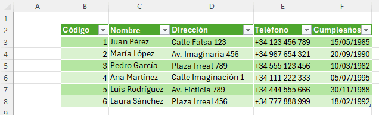{.rounded-4}

> [!TIP]
>
> En Excel, para añadir filas o columnas a una tabla, simplemente agrega datos a la derecha de la última columna o debajo de la última fila. Excel entenderá que deseas ampliar la tabla. 😊

## Crear una tabla

Para **crear una tabla**, seguiremos los siguientes pasos:

1. Seleccionar `Insertar` > `Tabla`.

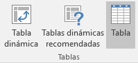{.rounded-3}

2. Aparecerá a continuación el cuadro de diálogo **Crear tabla**.

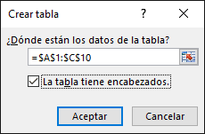{.rounded-3}

3. Y en la hoja de cálculo aparece el rango seleccionado con el formato propio de la tabla.

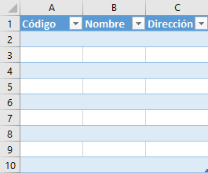{.rounded-3}

Ahora podemos **ordenar** los registros, **filtrar** contenidos y **aplicar formatos** de una forma más rápida e intuitiva. Sin olvidar de lo bonita que queda la tabla 😍.

---

# Trabajar con distintas hojas

🟩Trabajar con distintas hojas en Excel puede ser muy útil para organizar y gestionar datos de manera eficiente. Aquí tienes algunas razones por las que trabajar con múltiples hojas es beneficioso:

1. **Organización**: Al dividir la información en diferentes hojas, puedes mantener tus datos más organizados. Cada hoja puede representar una categoría o tema específico, lo que facilita la búsqueda y el análisis.
2. **Comparación y análisis**: Al trabajar con dos o más hojas simultáneamente, puedes realizar comparaciones y análisis más eficientes. Por ejemplo, puedes dividir la pantalla para ver dos hojas al mismo tiempo y comparar datos rápidamente. También puedes copiar y pegar datos entre hojas para organizar la información según tus necesidades.
3. **Referencias entre hojas**: Excel te permite utilizar referencias entre hojas para realizar cálculos más complejos. Puedes hacer referencia a celdas en otras hojas para crear fórmulas que involucren datos de diferentes lugares.

# Nombres de variables

🟩Por otro lado, podemos ponerle nombres a las celdas para referenciarlas por su nombre, en lugar de su fila y columna. Aquí están algunos beneficios:

1. **Claridad y legibilidad**: Al dar nombres significativos a tus variables, puedes hacer que tus fórmulas y cálculos sean más legibles. En lugar de referenciar celdas por su dirección (como `A1` o `B2`), puedes usar nombres descriptivos como “`Ingresos`” o “`Gastos`” para que sea más fácil entender el propósito de cada variable.
2. **Facilidad de mantenimiento**: Si tienes una fórmula compleja que utiliza varias celdas, asignar nombres a esas celdas te permite actualizarlas más fácilmente. Por ejemplo, si cambias el nombre de una variable, Excel automáticamente actualizará todas las referencias a esa variable en tus fórmulas.
3. **Referencias más intuitivas**: Cuando trabajas con varias hojas en Excel, puedes hacer referencia a las variables de otras hojas utilizando sus nombres. Esto es especialmente útil cuando creas fórmulas que involucran datos de diferentes lugares. Por ejemplo, si tienes una hoja de “Ventas” y otra de “Gastos”, puedes usar los nombres de las variables para calcular el beneficio neto en una tercera hoja.

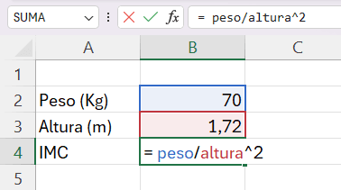{.rounded-4}

> [!tip]
>
> Aquí puedes ver en el ejemplo que hemos "renombrado" a las celdas por su nombre (`peso` y `altura`), en lugar de por su referencia, por lo que la fórmula se entiende mucho mejor que usando referencias (`B2` y `B3`).

Aquí tienes dos formas sencillas de hacerlo:

1. **Usando la función de la Caja de Nombres**:
   - La **Caja de Nombres** en Excel es una pequeña caja rectangular que se encuentra a la izquierda de la barra de fórmulas. Su función principal es mostrar y permitir a los usuarios navegar entre referencias de celdas y rangos con nombres en la hoja de cálculo.
   - Para asignar un nombre a una celda utilizando la Caja de Nombres, sigue estos pasos:
     1. Selecciona la celda a la que deseas asignar un nombre.
     2. Haz clic en la **Caja de Nombres**.
     3. Escribe el nombre deseado y presiona <kbd>Intro</kbd>.
   - Por ejemplo, podrías asignar el nombre “cantidadZanahoria” a la celda D5. Luego, podrías usar este nombre en una fórmula, como: `=PRODUCTO(cantidadZanahoria; precioUnitarioZanahoria)`.
2. **Usando el Comando “Nombres Definidos”**: Hay varias opciones, veamos las más simples:
   - Desde la cinta de opciones:
     1. Selecciona la celda a la que deseas asignar un nombre.
     2. Ve a la pestaña **Fórmulas** y selecciona **Nombres Definidos** > **Definir Nombre**.
     3. En el cuadro de diálogo **Nuevo Nombre**, escribe el nombre deseado en el campo “Nombre”.
     4. Selecciona la hoja de cálculo como **Ámbito**.
     5. Haz clic en **Aceptar**.
   - Desde el menú contextual (botón derecho):
     1. Selecciona la celda a la que deseas asignar un nombre.
     2. Pulsa botón derecho del ratón y pulsa en **Definir Nombre**.
     3. En el cuadro de diálogo **Nuevo Nombre**, escribe el nombre deseado en el campo “Nombre”.
     4. Selecciona la hoja de cálculo como **Ámbito**.
     5. Haz clic en **Aceptar**.

> [!TIP]
>
> En `Fórmulas` > `Nombres definidos` > `Administrador de nombres` encontrarás una ventana donde poder administrar todas las variables creadas en el libro.
>
> 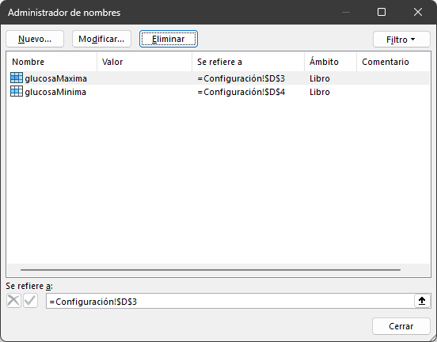{.rounded-4}

> [!WARNING]
>
> Sigue estas reglas recomendadas para nombrar tus celdas en Excel de manera efectiva: 
>
> - **Usa nombres descriptivos:** Elige nombres que reflejen claramente el contenido o el propósito de la celda. Por ejemplo, si estás registrando ventas mensuales, podrías nombrar una celda como “`ventasEnero`” o “`totalAnual`”.
> - **Las palabras se escriben juntas y sin espacios**, por ejemplo `ventasAnuales`, `porcentajeTotal`.
> - **Evita caracteres especiales** y comienza siempre con una letra minúscula.

 

---

# Gráficos

Un **gráfico** es la **representación gráfica de los datos** de una hoja de cálculo y **facilita su interpretación**.

En esta unidad, vamos a ver cómo **crear gráficos a partir de unos datos introducidos en una hoja de cálculo.** La utilización de gráficos hace más sencilla e inmediata la interpretación de los datos. A menudo, un gráfico nos dice mucho más que una serie de datos clasificados por filas y columnas.

## Crear gráficos

Para insertar un gráfico tenemos varias opciones, pero siempre utilizaremos pestaña **`Insertar`** > **`Gráficos`**.

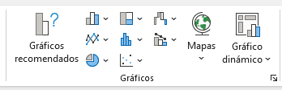{.rounded-4}

1. Selecciona el rango de celdas que quieres que participen en el gráfico. De esta forma, Excel podrá generarlo automáticamente.

2. Selecciona "`Gráficos recomendados`". Excel te mostrará una recomendación de gráficos que sean más representativos para los datos elegidos. Siempre puedes elegir el que quieras. Una vez elegido, haces clic en Aceptar y se incluirá un gráfico en el libro.

   

**Ejemplo**

Tenemos los siguientes datos de fechas, temperatura y humedad relativa.

1. Seleccionamos los datos que queremos representar en el gráfico. Todo no, ya que no tendría sentido mezclar temperaturas con humedad. Así que seleccionamos las fechas y la temperatura. 

2. Pulsamos en Insertar gráfico recomendados.

3. Vemos que el gráfico tiene sentido y que representaría correctamente una progresión de unos días y la evolución de la temperatura. Así que pulsamos **Aceptar**.

   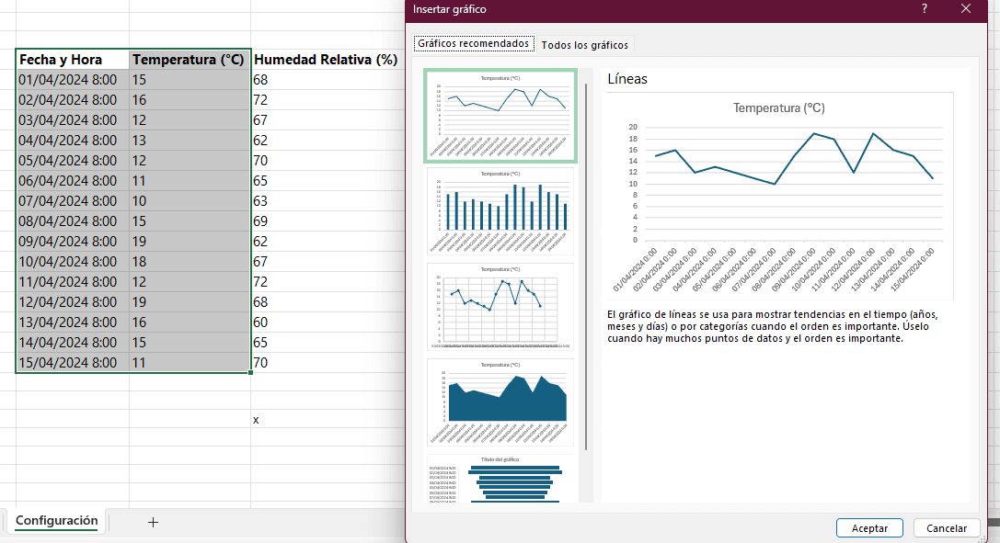{.rounded-4}

4. Y ya solo nos quedaría personalizar el gráfico. Moverlo, colores, rótulos, tamaños, etc. 

   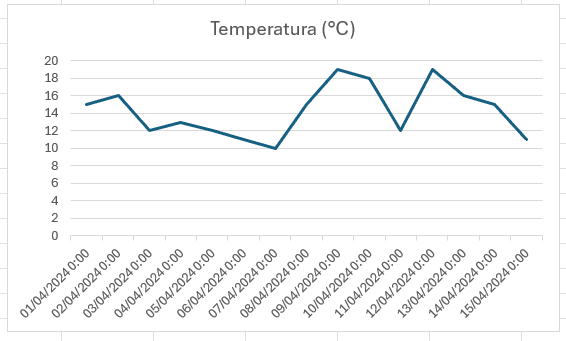{.rounded-4}

> [!TIP]
>
> Haciendo clic sobre el pincel que aparece a la derecha, podemos cambiar el estilo, colores, forma de los datos, TODO.
>
> Las opciones de personalización de gráficos son muchísimas. Por lo que te recomendamos paciencia y mucho ensayo y error. Es imposible verlas todas en un curso tan corto 😅.
>
> 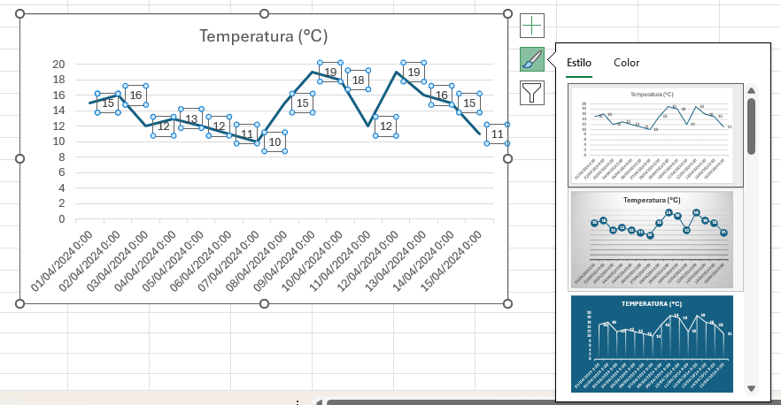{.rounded-4}

## 👨‍🏫Ejercicio 7

Crea un libro nuevo con los siguientes datos:

| Mes        | Ingresos | Gastos |
| ---------- | -------- | ------ |
| Enero      | 1034     | 2500   |
| Febrero    | 1405     | 1000   |
| Marzo      | 1794     | 1232   |
| Abril      | 2700     | 1800   |
| Mayo       | 2900     | 1734   |
| Junio      | 3000     | 3530   |
| Julio      | 3200     | 2340   |
| Agosto     | 3100     | 3000   |
| Septiembre | 2700     | 2100   |
| Octubre    | 2542     | 2400   |
| Noviembre  | 3000     | 2200   |
| Diciembre  | 3200     | 2500   |

Queremos hacer lo siguiente:

1. Añadir una columna de beneficios, que serán los ingresos menos los gastos.
2. Añadir filas de totales en los ingresos, gastos y beneficios.
3. Dar formato como tabla a los datos, para mejorar la visibilidad y manejo de la información.
4. Añadir un formato condicional para las cifras en negativo (que se vea en rojo).
5. Añadir un gráfico de barras para ver la evolución de los gastos e ingresos.

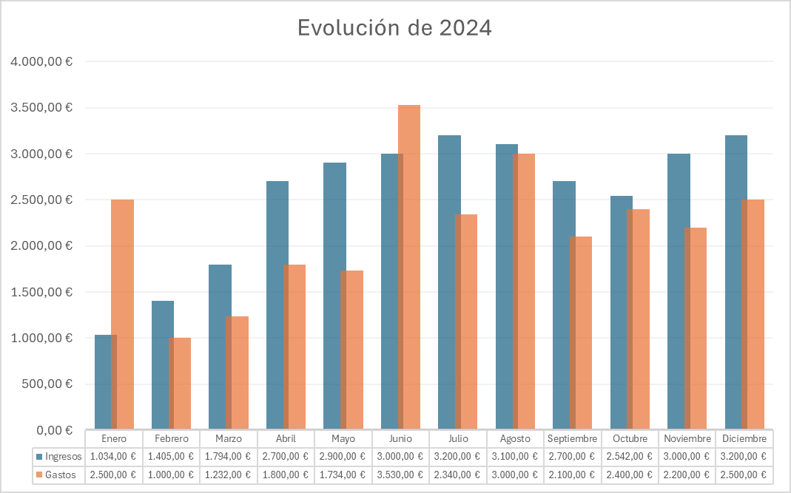{.rounded-4}

Hazlo mas o menos así. No te preocupes si no es exactamente igual. Dale tu toque personal👩‍🎨.

---

## Añadir una serie de datos

Este paso es el más importante de todos ya que en él **definiremos qué datos queremos que aparezcan en el gráfico**. Si observamos la pestaña **Diseño,** encontraremos dos opciones muy útiles relacionadas con los **Datos**:

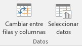

Primero nos fijaremos en el botón **Seleccionar datos**. Desde él se abre el siguiente cuadro de diálogo:

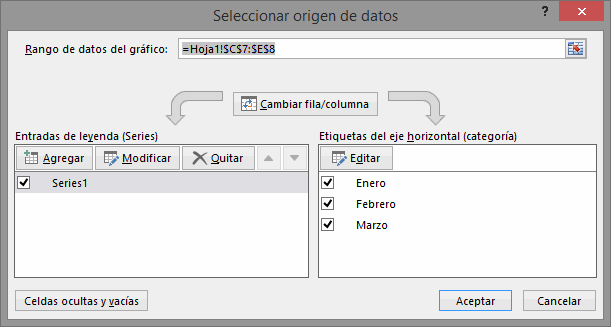{.rounded-4}

En el campo **Rango de datos del gráfico**, debemos indicar el rango de celdas que se tomarán en cuenta para crear el gráfico. En el caso de la imagen, hemos englobado de la celda **C7** a la **E8** (6 celdas). Para escoger los datos puedes escribir el rango o bien pulsar el botón {.img-inline} y seleccionar las celdas en la hoja.

Una vez hayamos acotado los datos que utilizaremos, Excel asociará unos al eje horizontal (categorías) y otros al eje vertical (series). Ten en cuenta que hay gráficos que necesitan más de dos series para poder crearse (por ejemplo, los gráficos de superficie) mientras que otros, en cambio, (como el que ves en la imagen) se bastan con una sola.

Utiliza el botón **Editar** o **Modificar**, dependiendo del eje, para **modificar el literal** (texto) que se mostrará en la leyenda de series del gráfico, o el rango de celdas de las series o categorías. En nuestro caso, por ejemplo, cambiaremos **Series1** por **Ventas**.

El botón **Cambiar fila/columna** intercambia los datos de las series y las categorías. Este botón actúa del mismo modo que el que podemos encontrar en la banda de opciones **Cambiar entre filas y columnas** disponible en la pestaña **Diseño**.

Si haces clic en el botón **Celdas ocultas y vacías,** abrirás un pequeño cuadro de diálogo desde donde podrás elegir qué hacer con las celdas **que no tengan datos o estén ocultas**.

Los cambios que vas realizando en la ventana se van viendo plasmados en un gráfico. Cuando acabes de configurar el origen de datos, pulsa el botón **Aceptar**.

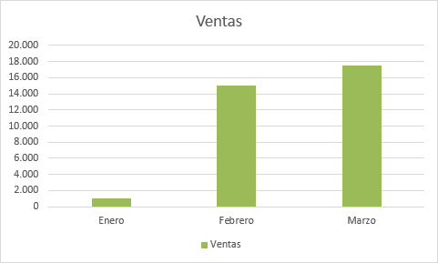{.rounded-4}

## 👨‍🏫Ejercicio 8

Tienes los siguientes datos:

| Alumno    | Actitud | Teoría | Práctica | Asistencia | Participación |
| --------- | ------- | ------ | -------- | ---------- | ------------- |
| Luna      | 5       | 5      | 10       | 0          | 1             |
| Sebastián | 4       | 2      | 9        | 10         | 10            |
| Valentina | 0       | 9      | 5        | 4          | 1             |
| Mateo     | 1       | 8      | 0        | 7          | 0             |
| Camila    | 9       | 4      | 9        | 9          | 4             |
| Nicolás   | 9       | 7      | 0        | 10         | 4             |
| Isabella  | 0       | 1      | 10       | 2          | 6             |
| Daniel    | 9       | 6      | 6        | 4          | 4             |
| Sofía     | 3       | 1      | 10       | 9          | 3             |
| Alejandro | 3       | 3      | 7        | 2          | 9             |

- Cada puntuación es un número aleatorio generado por excel entre 0 y 10. Busca en las fórmulas a ver si encuentras algo para eso.
- Crea una nueva columna con la nota media para cada alumno.
- Inserta un gráfico representativo sobre los datos. Puede ser un gráfico donde se muestren todos los alumnos, o bien uno donde podamos elegir algunos alumnos y comparar sus notas.
- Elige bien las series y categorías, invierte las filas y las columnas si lo ves necesario y usa los filtros para mostrar todos los alumnos o solo unos cuantos.

---

# 👨‍🏫Ejercicios extras

Una vez terminados los ejercicios propuestos por cada unidad, te proponemos distintos ejercicios de refuerzo donde podrás practicar con todo lo aprendido durante el curso:

## Ejercicio 9

> [!IMPORTANT]
>
> En este ejercicio practicaremos todo lo que hemos visto en el curso por lo que es altamente recomendable que lo hagas🤓.

Supongamos que estamos en un curso en el que tenemos que asistir un determinado número de horas. Para llevar un control, haremos una hoja de cálculo donde indicaremos las horas que asistimos cada jornada del curso. Para ello haremos lo siguiente:

1. Vamos a poner en una columna todas las jornadas (días) que tenga el curso. En nuestro caso son 10 días. Usa mejor las fechas reales de tu curso.

2. En la siguiente columna, añadiremos las horas que hemos asistido cada día. Los días que no hayas asistido todavía, déjalos en blanco. Algo como la siguiente imagen:

   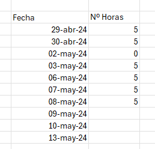{.rounded-4}

3. En la parte derecha de la hoja de cálculo, es donde haremos los cálculos para mostrarlos, de la siguiente manera:

   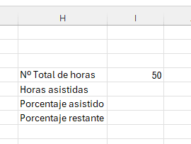{.rounded-4}

4. Asigna un nombre a cada celda. Si no recuerdas como, puedes repasar el apartado que vimos en [Nombres de variables](#Nombres de variables).

   - Nº Total de horas le llamaremos `horasTotalesCurso`.
   - Horas asistidas le llamaremos `horasAsistidas`.
   - Porcentaje asistido le llamaremos `porcentajeAsistido`.
   - Porcentaje restante le llamaremos `porcentajeRestante`.
   - Selecciona el rango donde incluimos las horas que estamos asistiendo y ponle el nombre de `numeroHoras`.

5. Los cálculos serán:

   - El valor de **número total de horas** lo escribimos nosotros a mano, por ejemplo, si nuestro curso tiene 50 horas, escribimos ese dato. Lo necesitaremos para calcular el porcentaje parcial.
   - El valor de **Horas asistidas** será la suma de las todas las celdas que deberán contener un número de horas.
   - El valor de **Porcentaje asistido**, lo calcularemos haciendo una regla de 3 🤯.
   - El valor de **Porcentaje restante**, será 100 - Porcentaje Asistido.
   - Fíjate que las fórmulas son más claras y entendibles usando nombres que referencias a celdas.

6. **Dale un formato a las tablas** y celdas para que se vea más bonito.

7. **Inserta el logo** de la empresa que está impartiendo el curso. Búscalo en internet y ponlo bonito en algún sitio de la hoja principal.

8. **Inserta un gráfico circular** para representar el el **porcentaje asistido y restante**. 

9. **Crea una Hoja nueva** en el libro, y copia el gráfico allí para poder ponerlo más grande y que se vea bien. Puedes borrar el gráfico original, **que solo quede el nuevo gráfico en la nueva hoja**.

10. Vamos a **validar la entrada de datos** de forma que en el número de horas diaria, solo podamos introducir un número de 0 al número de horas diarias que tenga tu curso.

11. Vamos a añadir los siguientes formatos condicionales: 

    1. Que nos aparezca en rojo cuando tenemos un porcentaje asistido del 0 al 50, en amarillo si es mayor de 50 y menor de 75, y en verde si es mayor o igual a 75.
    2. Prueba a usar un conjunto de iconos ade de darle estilo a la celda. Algo como {.img-inline} o {.img-inline}.

12. Muestra dos celdas nuevas, que cuente el número total de días que tiene el curso y el número total de días introducidos, teniendo en cuenta que si dejamos una celda de las horas en blanco es que no se ha introducido, y si tiene un número (cualquiera) es que se ha introducido. No hay pistas. ¡Tu puedes 💪!.

    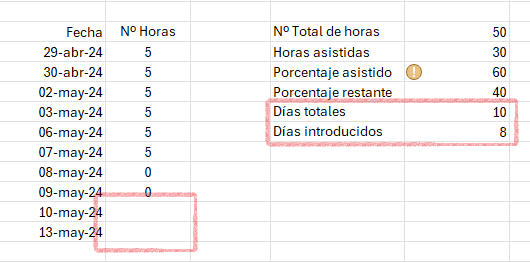{.rounded-4}

## Ejercicio 10

✍️Fórmulas básicas e introducción de datos

Introducir en una celda la altura de una persona (en metros) y en una celda su peso (en kilos). Mostrar en otra celda su índice de masa corporal (IMC). Para calcular el IMC usaremos la siguiente fórmula:
$$
IMC = peso / altura^2
$$
{.rounded-3}

## Ejercicio 11

**Contexto:**

Una empresa necesita llevar el registro diario de la jornada laboral de sus empleados. Cada trabajador registra la hora de entrada y la hora de salida. Las horas trabajadas se calculan diariamente, y aquellas que exceden las 8 horas se consideran horas extra. Las horas normales se pagan a 10 €/hora y las extras a 15 €/hora.

**Objetivo:**

Crear una hoja de cálculo que:

- Permita ingresar la **fecha**, la **hora de entrada** y la **hora de salida**.
- Calcule automáticamente las **horas trabajadas** cada día.
- Distinga las **horas normales** de las **horas extra** (por encima de 8 horas).
- Calcule el **sueldo diario**, separando la paga por horas normales y por horas extra.
- Totalice el **sueldo semanal** o mensual.

**Datos de ejemplo:**

| Fecha      | Hora Entrada | Hora Salida | Horas Totales | Horas Normales | Horas Extra | Pago Normal | Pago Extra | Sueldo Diario |
| ---------- | ------------ | ----------- | ------------- | -------------- | ----------- | ----------- | ---------- | ------------- |
| 01/07/2025 | 08:30        | 18:45       |               |                |             |             |            |               |

