[TOC]

# PowerPoint

## Introducción

**Microsoft PowerPoint** es un software informático de presentaciones, que forma parte de la suite Office, que permite **crear diapositivas** con texto, imágenes, vídeos, gráficos, elementos 3D y otros elementos multimedia. Con PowerPoint, los usuarios pueden diseñar presentaciones visuales y dinámicas para comunicar información de manera clara y efectiva.

## Uso de PowerPoint

Algunos ejemplos de su aplicación práctica podrían ser:

- En la enseñanza, como apoyo al profesor para desarrollar un determinado tema.
- La exposición de los resultados de una investigación.
- Como apoyo visual en una reunión empresarial o conferencia.
- Presentar un nuevo producto.
- Y muchos más...

En definitiva, siempre que se quiera exponer información de forma visual y agradable para captar la atención del interlocutor.

---

# Elementos de la pantalla principal 

Al iniciar PowerPoint, aparece una **pantalla inicial** como la que te mostramos a continuación. Ahora conoceremos los **nombres de los diferentes elementos** de esta pantalla y así será más fácil entender el resto del curso.

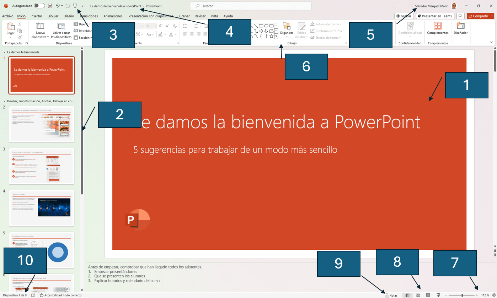

La ventana se puede personalizar para cambiar las herramientas y botones que hay disponibles, de modo que debes tomar las imágenes del curso como un recurso orientativo, que puede no ser idéntico a lo que veas en tu pantalla.

Hemos incluido notas descriptivas de cada elemento. Es importante que te vayas familiarizando con los nombres de cada uno, para que sigas fácilmente las explicaciones, ya que se suelen utilizar estos términos.

Comentemos, a grandes rasgos, las **características** de cada elemento.

1. En la parte central de la ventana es donde visualizamos y creamos las **diapositivas** que formarán la presentación. Una diapositiva no es más que una de las muchas pantallas que forman parte de una presentación, es como una página de un libro.

2. **El área de esquema** muestra en miniatura las diapositivas que vamos creando referenciadas con su número. Al seleccionar una diapositiva en el área de esquema aparecerá inmediatamente la diapositiva en el área de trabajo central para poder modificarla.

3. La **barra de herramientas de acceso rápido** {.img-inline} contiene, normalmente, las opciones que se utilizan más frecuentemente. Éstas son **Guardar**, **Deshacer**, **Rehacer** y **Presentación desde el principio** (para comenzar con la presentación de diapositivas a pantalla completa). 

4. La **barra de título** contiene el nombre del documento abierto que se está visualizando, además del nombre del programa. En este caso el nombre es **`Le damos la bienvenida a PowerPoint`**.

5. En la zona superior derecha tenemos el **nombre del usuario** que se ha conectado y más a la derecha los botones minimizar, maximizar/restaurar y cerrar, comunes en casi todas las ventanas del entorno Windows.

6. La **cinta de opciones** es el elemento más importante de todos, ya que se trata de una franja que contiene las herramientas y utilidades necesarias para realizar acciones en PowerPoint. Funciona igual que en el resto de aplicaciones de Office, pero con las herramientas propias para PowerPoint.

7. Al modificar el **zoom**, podremos alejar o acercar el punto de vista, para apreciar en mayor detalle o ver una vista general de las diapositivas que se encuentran en el área de trabajo.

8. Con los botones de vistas {.img-inline} podemos elegir el **tipo de Vista** que queremos utilizar según nos convenga. Por ejemplo, podemos tener una vista general de todas las diapositivas que tenemos, también podemos ejecutar la presentación para ver cómo queda, etc.

9. El **Área de notas** será donde añadiremos las anotaciones de apoyo para realizar la presentación. Para mostrarla u ocultarla, pulsaremos sobre el botón **Notas** {.img-inline}.

   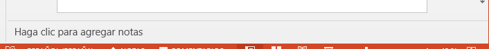

10. La **barra de estado** muestra información del estado del documento, como el número de diapositiva en el que nos encontramos y el total de diapositivas, etc.

---

# Crear presentación

Los nuevos "documentos" en PowerPoint se le denominan **presentaciones**, y cada "hoja" de las que están compuestas se le denominan **diapositivas**. Podemos decir que una presentación está compuesta de una o varias diapositivas, que se van presentando de forma secuencial una tras otra.

A continuación, veremos dos formas de crear una nueva presentación: partiendo de **una en blanco** y partiendo de **una plantilla**.

🟧 **Crear presentación en blanco**.

Para crear una presentación en blanco haremos clic en **Archivo** > **Nuevo**. Veremos una pantalla similar a esta.

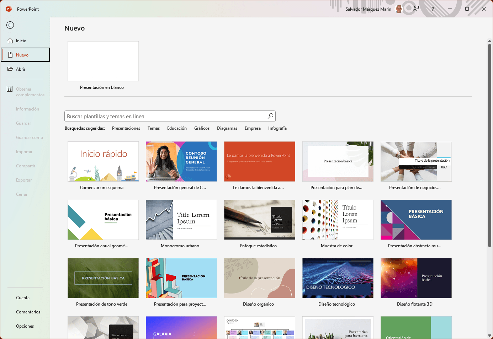

Pulsando sobre la opción **Presentación en blanco**, se nos abrirá una nueva ventana con un nuevo proyecto, en este caso, en blanco, como se ve a continuación.

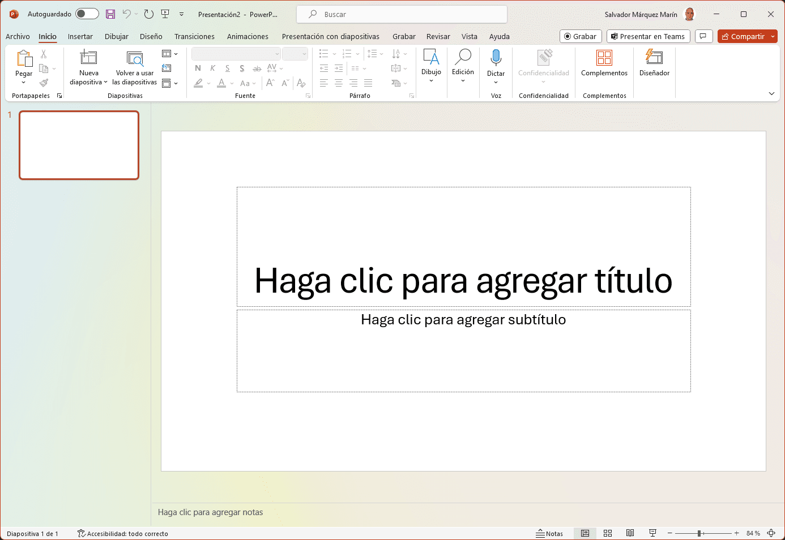

Veremos que ha creado una diapositiva nueva, con dos cuadros de texto, uno para el título y otro para el subtítulo. Obviamente podemos editar este contenido y hacer nuestra presentación a nuestro gusto.

🟧**Crear una presentación a partir de una plantilla.**

Las plantillas son muy útiles porque generan una presentación base a partir de la cual es mucho más sencillo trabajar. Es decir, nos adelantan el trabajo.

Para utilizar plantillas, los pasos son muy similares a los que acabamos de ver. Hacemos clic en **Archivo** > **Nuevo**, pero esta vez seleccionamos una plantilla distinta a la de presentación en blanco de entre las que se nos ofrecen como alternativa. 

Podemos escribir en el cuadro de búsqueda algún tema concreto, hacemos clic sobre alguna y descargamos la plantilla.

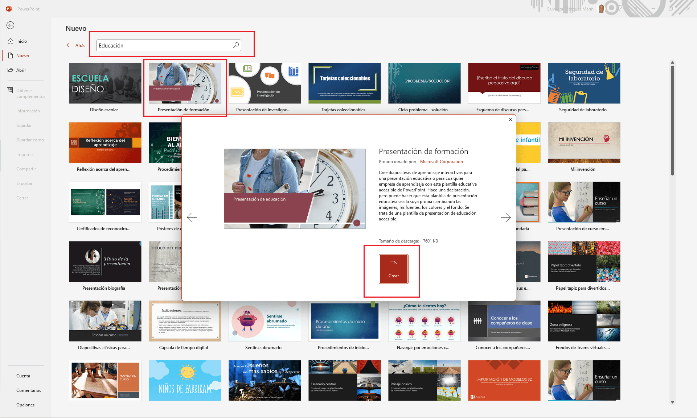

Una vez descargada, nos abrirá una presentación con un contenido que podremos editar y modificar a nuestro antojo, con muchas diapositivas con imágenes y un diseño moderno. Muy útil para cuando no tenemos muchas ideas para hacer nuestra presentación.

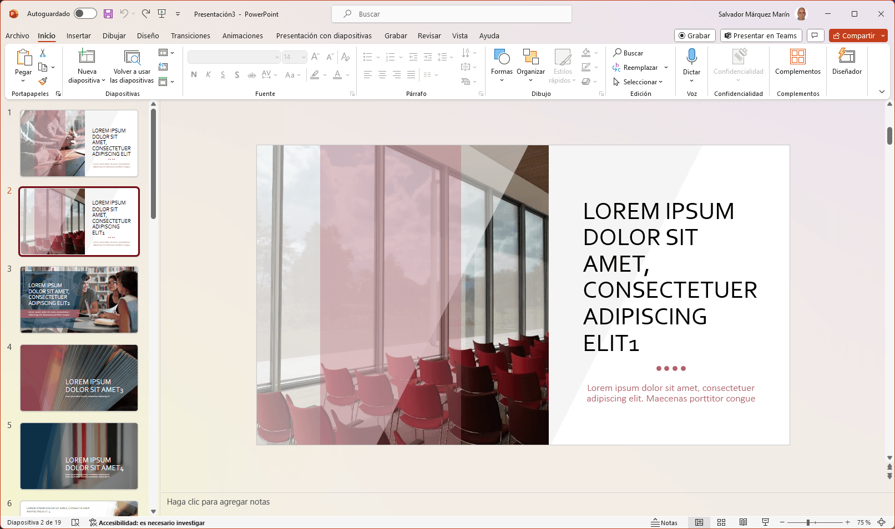

---

# Cambiar de vista

El saber manejar los tipos de vistas es muy importante ya que nos va a permitir tener tanto una visión particular de cada una de las diapositivas como una visión global de todas ellas, así como reproducir la presentación para ver el resultado al final.

Podemos cambiar de una vista a otra desde la pestaña **`Vista`** > **`Vistas de presentación`**. 

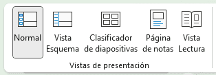

También desde la esquina inferior derecha {.img-inline}.

Las más útiles son:

🟧**Vista normal**: La **vista normal** es la que se utiliza para **trabajar habitualmente**. Con ella podemos ver, diseñar y **modificar la diapositiva** que seleccionamos. Se muestra en la izquierda un esquema con las miniaturas de las diapositivas y a la derecha una zona más grande con la diapositiva seleccionada.

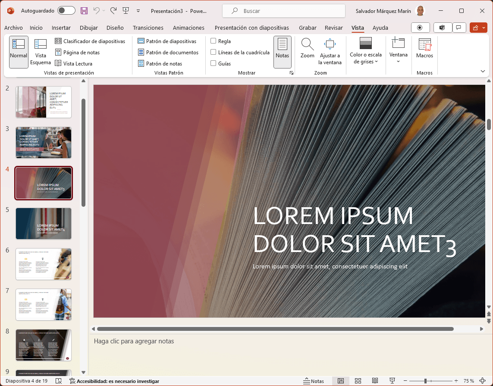

🟧**Vista clasificador de diapositivas**: La **vista clasificador** muestra las **diapositivas en miniatura** y ordenadas por el orden de aparición. Dicho orden se representa con un pequeño número situado en la esquina inferior izquierda de cada una de las diapositivas. También pueden aparecer clasificadas en secciones, si así lo hemos establecido.

Por lo tanto, con este tipo de vista tenemos una **visión más global** de la presentación. Nos permite localizar una diapositiva más rápidamente y es muy útil para mover, copiar o eliminar las diapositivas. En definitiva, **para organizarlas**.

Para **mover las diapositivas** de lugar, **basta con hacer clic con el botón izquierdo del ratón** sobre una diapositiva y **arrastrarla** hasta la posición deseada y soltar el botón del ratón. 

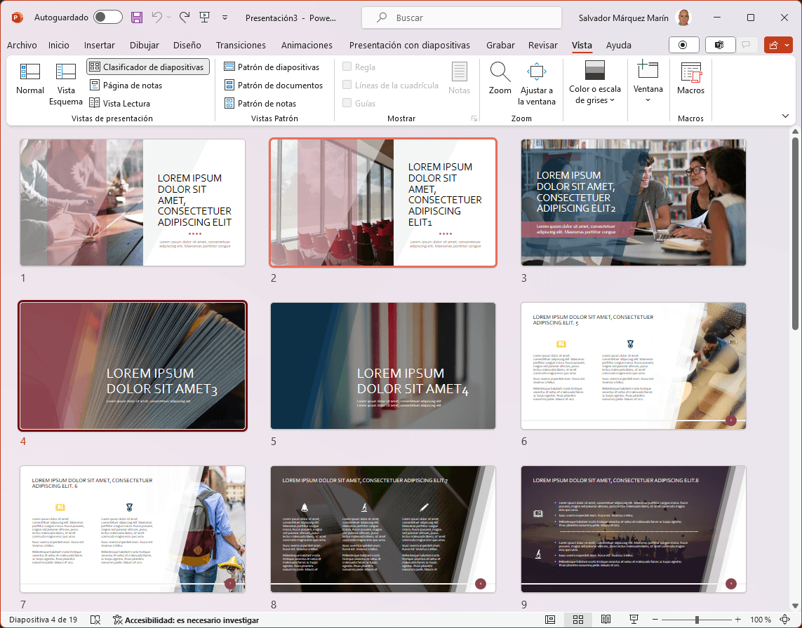

🟧**Zoom**: No es exactamente una vista, pero permite **acercar** o **alejar** las zonas de algunas vistas. Es decir, en cualquier vista, podemos hacer zoom a una zona concreta, como puede ser el esquema de las diapositivas a la izquierda o bien a la diapositiva central, de forma que le demos más o menos espacio a esa zona para mejorar nuestra zona de trabajo. 

La forma más fácil de usar el zoom es colocando el cursor del ratón sobre la zona que queramos acercar o alejar y pulsando <kbd>Control + rueda del ratón</kbd>. Así se ampliará o acercará la zona concreta que tengamos seleccionada.

🟧**Vista presentación con diapositivas:** Esto reproduce la presentación para mostrar cuál será el resultado final. Encontraremos estas opciones en la cinta de opciones, en `Presentación con diapositivas` > `Iniciar presentación con diapositivas`. 

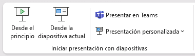

Las más útiles son:

- **Desde la diapositiva actual:** Lo habitual es reproducir la presentación desde la diapositiva que se está visualizando en ese momento, normalmente para ver cómo queda la diapositiva que acabamos de realizar y poder apreciar todos los elementos, incluidos los efectos animados que no se apreciarían en ninguna otra vista. También se puede desde el último botón de la barra de título {.img-inline}.
- **Desde el principio:** Reproduce la presentación desde la primera diapositiva, independientemente de la diapositiva que esté seleccionada. Por si queremos ver el resultado final total.

---

# Trabajar con diapositivas

## Crear una nueva diapositiva

Para añadir una nueva diapositiva, en el esquema de diapositivas, seleccionamos la posición dónde queremos insertar nuestra nueva diapositivas, y después usaremos **`Inicio`** > **`Diapositivas`** > **`Nueva diapositiva`**.

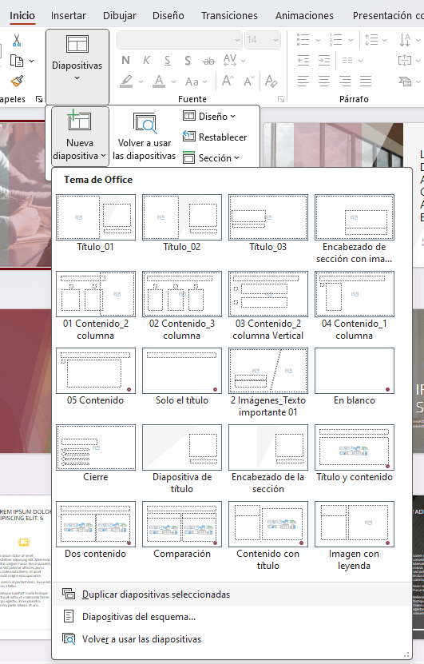

Nos mostrará una selección plantillas para diapositivas nuevas, **seleccionaremos la que más nos convenga** según el diseño y se insertará después de la diapositiva que teníamos seleccionada. Si no había ninguna, se añadirá nuestra primera diapositiva a la presentación.

Ahora tendremos una diapositiva en blanco, lista para añadirle los contenidos que queramos.

> [!TIP]
>
> También se puede `seleccionando una diapositiva` > `botón derecho del ratón` > `Nueva diapositiva`. Aunque así no podremos elegir una plantilla.

## Duplicar una diapositiva

Muchas veces necesitaremos duplicar una diapositiva para reutilizar su diseño o su contenido. Hay varias formas, la más simple es:

`Seleccionar la diapositiva a duplicar` > `Botón derecho del ratón` > `Duplicar diapositiva`.

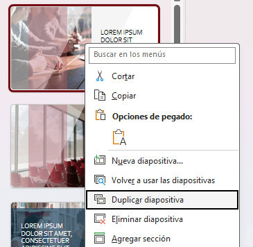

> [!TIP]
>
> También funcionará <kbd>Control + C</kbd> y <kbd>Control + V</kbd> para copiar y pegar la diapositiva y así duplicarla.

## Eliminar una diapositiva

Para eliminar una diapositiva de nuestra presentación, podemos hacer:

`Seleccionar la diapositiva a duplicar` > `Botón derecho del ratón` > `Eliminar diapositiva`.

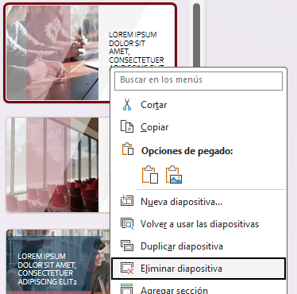

> [!TIP]
>
> También podemos pulsar la tecla <kbd>Supr</kbd> para eliminar las diapositivas seleccionadas.

## Moverlas (cambiarlas de orden)

Desde la vista **Normal**, o bien en la vista **Clasificador de diapositivas**, podemos mover las miniaturas de las diapositivas para reordenarlas y cambiar su orden de visualización en la presentación.

Para **mover las diapositivas** de lugar, **basta con hacer clic con el botón izquierdo del ratón** sobre una diapositiva y **arrastrarla** hasta la posición deseada y soltar el botón del ratón. 

## Seleccionar varias diapositivas

A veces querrás hacer acciones sobre varias diapositivas a la vez (borrarlas, moverlas, cambiarles el diseño, etc.), y para ello tendrás que seleccionarlas primero. Puedes hacerlo de la siguiente forma:

🟧**Diapositivas contiguas**: Hacemos clic sobre la primera de ellas y manteniendo pulsada la tecla <kbd>Mayús</kbd>, hacemos clic en la última que queramos seleccionar. Se deberían seleccionar todas las diapositivas comprendidas entre la primera y la última que hiciste clic.

🟧**Diapositivas no contiguas**: Si las diapositivas no están correlativas, presionamos la tecla <kbd>Control</kbd> y sin soltarla, vamos haciendo clic izquierdo sobre todas las diapositivas que queramos seleccionar. Se quedarán seleccionadas hasta que hagamos otra selección. 

> [!TIP]
>
> 🧐Como puedes observar, las diapositivas seleccionadas se distinguen por el borde coloreado que las rodea.

---

# Añadir contenido

Una vez que ya sabemos trabajar con diapositivas, el siguiente paso es rellenarlas de contenido. En las diapositivas tendremos **objetos**, que podemos aprovechar los que ya vienen incluidos en nuestra plantilla o bien insertarlos nosotros de forma independiente.

🟧**Aprovechar los objetos del diseño:**

Cuando creamos una nueva diapositiva, escogemos un diseño de entre los existentes. En muchos casos, el diseño incluye un elemento **objeto**, como el que se muestra en el recuadro inferior de la imagen siguiente.

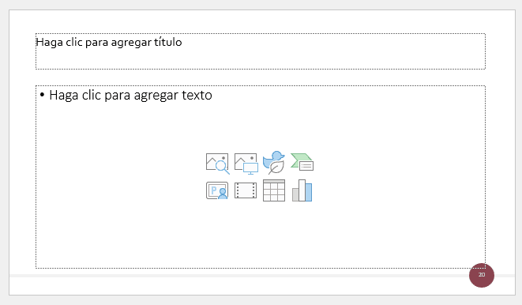

Una serie de imágenes representan los tipos de objetos que se pueden incluir. Al situar el cursor sobre ellas aparecerá un pequeño globo informativo que nos ayudará a identificarlos. Lo único que necesitamos saber es que cada imagen es un botón que inserta el tipo de objeto que representa: imágenes de archivo, del equipo, iconos, SmartArt, cameos, videos, tablas o gráficos. En función del tipo de objeto seleccionado se ejecutará una acción u otra que nos permitirá especificar las dimensiones de la tabla o qué imagen agregar, por ejemplo.

🟧 **Insertar objetos de forma independiente:**

Pero, ¿qué ocurre si queremos incluir más de un objeto en la diapositiva? ¿Dos, tres, diez? Para eso deberemos insertarlos manualmente desde la ficha **Insertar**.

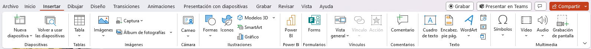

Prácticamente en su totalidad, son objetos que nos resultarán familiares ya sea de Word o de Excel. También hay otros nuevos, como elementos multimedia (audio, video), imágenes con la webcam, formularios, etc.

---

# Aplicar un tema

Igual que pasaba en Word y Excel, tenemos disponibles unos **temas para nuestra presentación**. Al aplicar un tema, toda ella adquirirá unos colores básicos que guardan cierta armonía y todas las diapositivas tendrán una coherencia estética. Se verán homogéneas sin apenas esfuerzo. También veremos que disponemos de **estilos rápidos** que nos permiten cambiar radicalmente el formato de un elemento de la diapositiva de forma inmediata.

Hay dos formas básicas de aplicar un tema a una presentación:

1. Cuando creas la presentación, al seleccionar una plantilla, ya tendremos un tema aplicado.

2. Si ya teníamos la presentación creada, podemos modificar el tema que se aplica a todas sus diapositivas desde la pestaña **Diseño**.

   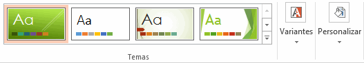

---

# Notas del orador

Las **notas del orador** en PowerPoint son una herramienta útil para los presentadores durante sus presentaciones. 

1. **¿Qué son las notas del orador?** Las **notas del orador** son un espacio reservado en cada diapositiva de una presentación en PowerPoint. Estas notas están destinadas a ser utilizadas por el presentador durante la exposición. A diferencia del contenido visible en las diapositivas, las notas del orador solo son visibles para quien está presentando y no para la audiencia.
2. **¿Para qué sirven las notas del orador?**
   - **Recordatorio de puntos clave:** El presentador puede incluir puntos clave, detalles importantes o recordatorios personales en estas notas. Esto ayuda a mantener el flujo de la presentación y asegura que no se olviden detalles cruciales.
   - **Chistes o anécdotas:** Las notas del orador también pueden contener chistes, anécdotas o comentarios adicionales que el presentador desea compartir con la audiencia para hacer la presentación más interesante o entretenida.
3. **Cómo agregar notas del orador en PowerPoint:**
   - Al crear una presentación, debes agregar las notas del orador en el **panel de notas** que aparece debajo de cada diapositiva. Si el panel está vacío, verás el texto “`Haga clic para agregar notas`”. Ahí es donde puedes escribir tus notas.
   - Durante la presentación, las notas del orador son visibles en el monitor del presentador, pero no en la pantalla proyectada para la audiencia.
   - Puedes acceder a las notas del orador desde la **vista Moderador**, que muestra las notas en un panel a la derecha mientras las diapositivas se proyectan en la pantalla principal.
4. **Cómo usar las notas del orador durante la presentación:**
   - Cuando estás conectado a un proyector y comienzas la presentación, la vista Moderador aparece en tu pantalla, mientras que la audiencia solo ve las diapositivas.
   - En la vista Moderador, puedes ver tus notas y editarlas si es necesario. También puedes ajustar el tamaño del texto en el panel de notas.
   - La Vista Moderador se configura automáticamente y recopila las notas escritas para cada diapositiva, facilitando su uso durante la presentación.

> [!NOTE] 
>
> Las notas del orador en PowerPoint son una herramienta valiosa para mantener el flujo de la presentación y agregar detalles adicionales sin que la audiencia los vea.

---

# Intervalos

Los **intervalos** en PowerPoint son una herramienta útil para controlar el tiempo de avance entre diapositivas durante una presentación. 

De esta forma no te alargarás o pasarás demasiado rápido por una diapositiva, además que puedes dejar que la presentación avance automáticamente las diapositivas según el tiempo que hayas estipulado.

1. **Cómo establecer intervalos en PowerPoint:**

   - Ve a la pestaña “Presentación con diapositivas”.
   - Selecciona la opción "Ensayar con intervalos". {.img-inline}
   - Se iniciará una presentación normal, y vas avanzando manualmente. Los tiempos que dejas cada diapositiva se irán registrando de forma automática. Una vez terminado la presentación, en la vista "**Clasificador de diapositivas**" podrás ver una marca de tiempo debajo de cada diapositiva.

   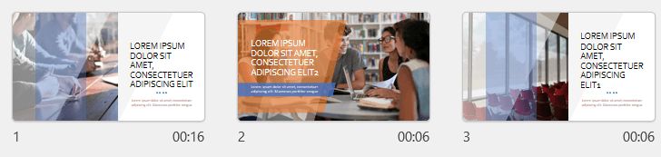

   

2. **Beneficios de usar intervalos:**

   - **Presentación más dinámica:** Los intervalos mantienen un ritmo constante y evitan que las diapositivas se muestren demasiado rápido o demasiado lento.
   - **Mayor control:** Puedes sincronizar animaciones, transiciones y narración con precisión.

3. **Consejos para usar intervalos:**

   - Practica la presentación con intervalos para asegurarte de que todo fluya correctamente.
   - Deja tiempo suficiente para que la audiencia asimile la información antes de avanzar a la siguiente diapositiva.

> [!CAUTION]
>
> Ten en cuenta la presentación avanzará a la siguiente diapositiva cada intervalo determinado, **pero si manualmente vuelves hacia atrás, el avance automático se detiene** temporalmente hasta que vuelvas a moverte manualmente hacia delante, momento en el que se activarán de nuevo los intervalos.

---

# Transiciones

La transición de diapositiva nos permite determinar cómo va a producirse el paso de una diapositiva a la siguiente a fin de lograr efectos visuales más estéticos.

Para aplicar la transición a una diapositiva, **selecciona la diapositiva** y despliega la ficha **`Transiciones`** > **`Transición a esta diapositiva`**.

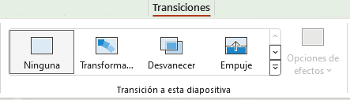

Si pulsamos en el botón para desplegar la ventana {.img-inline}, se mostrarán todas las transiciones disponibles:

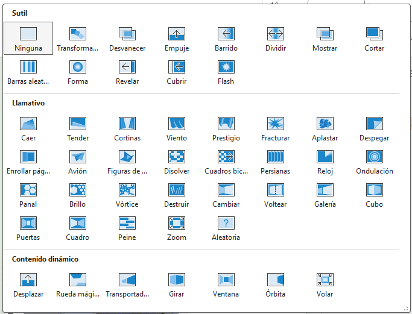

Al elegir una transición, veremos una vista previa de la misma y nos quedamos con la que nos guste. Hay que tener en cuenta que de esta manera **la transición solo se aplicará a esa diapositiva**.  

🟧En función de la transición escogida podremos modificar las **`Opciones de efectos`** desde el correspondiente botón. En el ejemplo siguiente, hemos seleccionado la transición **`Cubrir`** y para esta transición, las opciones de los efectos son todas las siguientes. Cada transición tiene sus propias opciones.

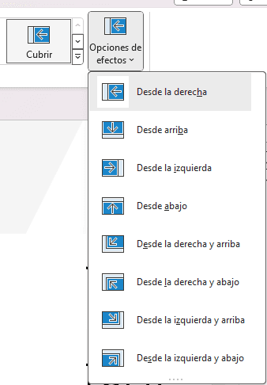

También podemos configurar la forma en que se ejecutará la transición desde el grupo **`Intervalos`**.

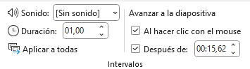

🟧Definiremos si queremos que suene algún **Sonido** durante la transición de entre los que se muestran en la lista.

- La duración del efecto.
- Y una característica muy importante, si la diapositiva cambiará a la siguiente **Al hacer clic con el mouse** o **Después de** un tiempo determinado. Recuerda que configuramos los intervalos en el capítulo [Intervalos](#Intervalos).

🟧El botón **Aplicar a todas** hace que la configuración escogida (sonido y transición) se aplique a todas las diapositivas de la presentación.

> [!TIP]
>
> Puedes comprobar qué diapositivas tienen efectos de transición o animaciones con un pequeño icono {.img-inline} debajo de las miniaturas de la izquierda de la vista **Normal** o en la vista **Clasificador de diapositivas**.
>
> 

---

# Animaciones

En las presentaciones podemos dar movimiento a los objetos e incluso al texto que forman parte de ellas, haciéndolas así más profesionales o atractivas, además de conseguir llamar la atención de las personas que la están viendo.

Para animar un texto u objeto lo primero que hay que hacer es seleccionarlo. A continuación, habrá que ir a la ficha **Animaciones**, grupo **Animación** y seleccionar cualquiera de las que se muestran.

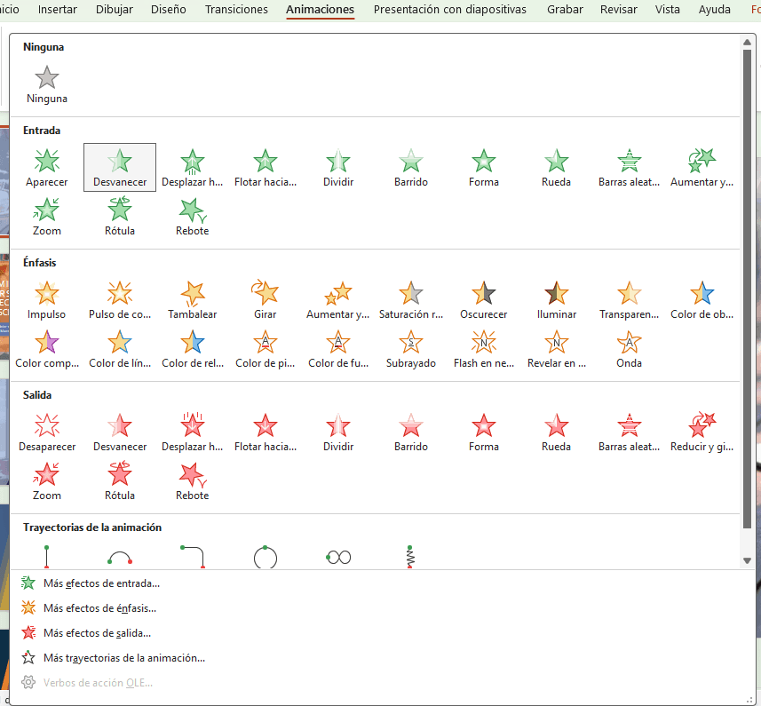

En función de la animación escogida se activará el botón **Opciones de efectos**, que nos permitirá personalizar algunos aspectos del efecto en sí. Por ejemplo, si escogemos una animación de desplazamiento, desde este botón podremos indicar en qué dirección se desplazará. Si escogemos una que añada algún objeto de color, podremos elegir qué color utilizar, etc.

Una vez aplicada la animación apreciarás en la diapositiva un pequeño número junto al objeto.

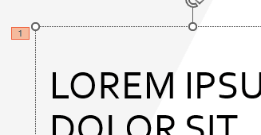

Los números se van asignado correlativamente a los objetos animados de la diapositiva. Además, percibiremos que el fondo del número se muestra rosado para aquel objeto que esté seleccionado. Así, si utilizamos la ficha de **Animaciones** para alterar algún efecto, sabremos siempre sobre qué objeto estamos trabajando.

Desde el grupo de **Intervalos** podremos definir si la animación se iniciará con un clic, si se iniciará a la vez que la anterior o si lo hará después de ella. Incluso podremos establecer la duración del efecto. El resultado final lo comprobaremos fácilmente, ya que, por defecto, el efecto se muestra en la vista **Normal**. Y también podremos forzar una **Vista previa** desde la cinta.

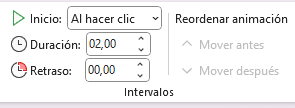

Para eliminar una animación, hacemos clic en su cuadrado con el número y pulsamos la tecla <kbd>Supr</kbd>.

Si observas la vista previa de las animaciones verás que se representan con una estrella que dibuja más o menos el efecto que produce. Esta estrella se aprecia en tres colores distintos:

- **Verde** para las **animaciones de entrada**. Es decir, las que se suelen aplicar para mostrar o iniciar el objeto.
- **Amarillo** para las **animaciones de énfasis**. Es decir, las que se centran en enfatizar el objeto, haciéndolo destacar sobre el resto.
- **Rojo** para las **animaciones de salida**. Estas dan un efecto al objeto para dar la impresión de que se va, o desaparece, es decir, de que hemos dejado de trabajar con él.

## Panel de animación

El **Panel de animación** se activa desde el grupo **Animación avanzada** y muestra un listado de todas las animaciones de la diapositiva. De esta manera, vemos más claramente el orden y los efectos aplicados, así como la forma en que se inician.

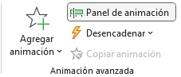

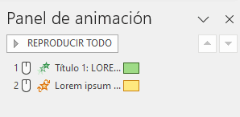

Por ejemplo, ahí podemos ver que:

- Hay dos animaciones.
- La primera es la animación "Flotar hacia arriba", se activa al hacer clic y forma parte del grupo de animaciones de entrada.
- La segunda es la animación "Tambalear", se activa al hacer clic y forma parte del grupo de animaciones de énfasis.

---

# 👨‍🏫Ejercicio

Vamos a proponerte un ejercicio final donde podrás realizar una presentación y exponerla en clase para todos tus compañeros y compañeras.

1. La idea es hacer una presentación de 5 diapositivas como máximo y expongas lo que has aprendido durante el curso. Puedes dedicar una diapositiva para Word, otra para Excel y otra para PowerPoint. En ellas puedes incrustar trozos de los ejercicios que hemos hecho (alguna tabla de Word, algún gráfico de Excel, de portal.office.com, lo que tu quieras).
2. Puedes elegir una plantilla o realizar todo el trabajo desde cero, como tu quieras. Ten en cuenta el tiempo que tengas disponible para realizar el ejercicio.
3. Una vez terminada, usa el botón de compartir (arriba a la derecha) {.img-inline} para darle acceso al tutor. Añade su correo electrónico y pulsa `Enviar`.

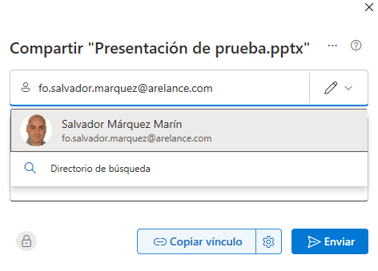

---

