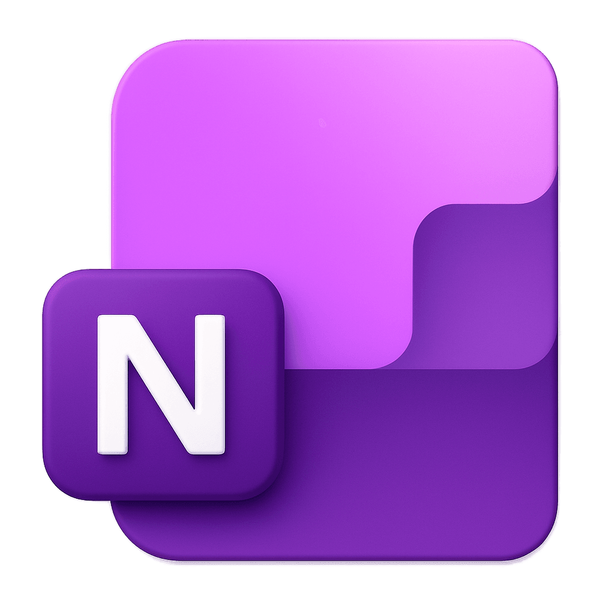
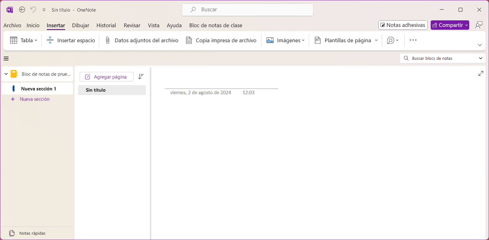
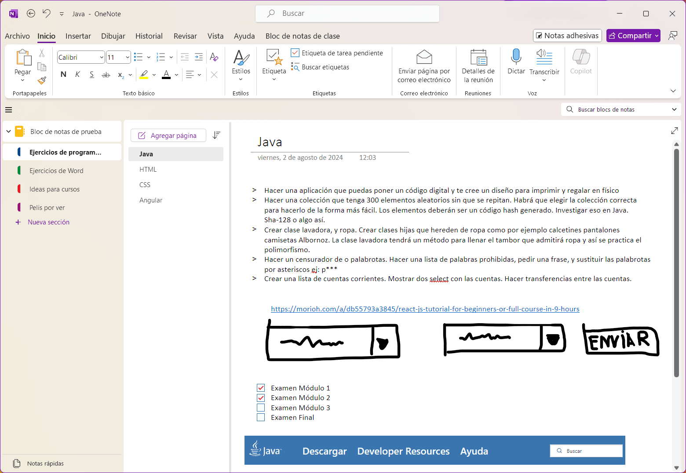
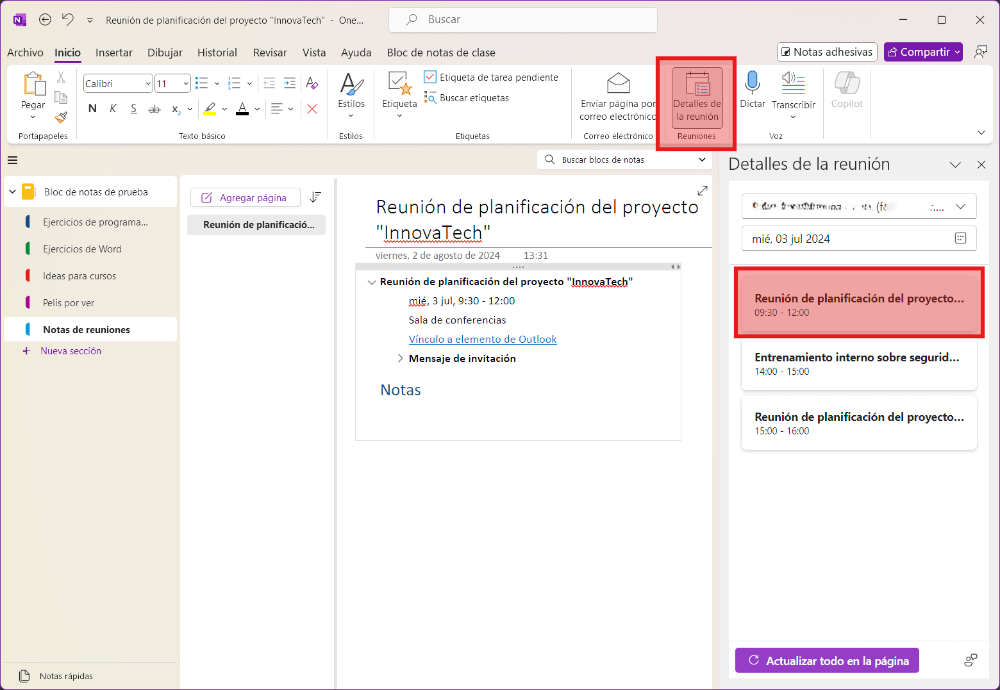

  5. OneNote

[TOC]

---

# OneNote

## Introducción

OneNote es como una libreta digital donde puedes anotar ideas, planificar proyectos, guardar recortes de información y mucho más. Piensa en ello como tu cuaderno de apuntes en formato digital, donde puedes escribir, dibujar y organizar todo tipo de contenido.

Para iniciarlo, tendremos varias opciones: 

- 💻La aplicación de escritorio, una vez instalada como Word, Excel o PowerPoint. 
- 🌐La versión online accesible desde [portal.office.com](https://portal.office.com).
- 📱La versión para móviles. Puedes instalarla en los siguientes enlaces:
  - Google Play: https://play.google.com/store/apps/details?id=com.microsoft.office.onenote&hl=es_419
  - Apple Store: https://apps.apple.com/es/app/microsoft-onenote/id410395246

> [!TIP]
>
> Como en el resto de aplicaciones de Microsoft 365, inicia sesión con tu cuenta de Microsoft (*hotmail*, *outlook* o corporativa) para obtener los beneficios de la sincronización entre dispositivos.

## ¿Para qué Sirve OneNote?

OneNote es útil para muchas cosas. Puedes usarlo para tomar notas en reuniones, guardar enlaces y artículos interesantes, hacer listas de tareas (¡sí, también listas!), y hasta dibujar diagramas o bocetos. Es una herramienta súper versátil, perfecta para estudiantes, profesionales, o cualquier persona que necesite organizar sus pensamientos y proyectos.

## Como se organizan las notas

En OneNote creamos documentos que llamamos Blocs de Notas. Están estructurados con los siguientes elementos:

### 1. Bloc de Notas

El primer nivel de organización es el **Bloc de Notas**. Piensa en él como un gran cuaderno de trabajo. Puedes tener un Bloc de Notas para el trabajo, otro para tus proyectos personales, y otro para cosas aleatorias como recetas de cocina o ideas locas para futuras vacaciones.

### 2. Secciones

Dentro de cada Bloc de Notas, tienes **Secciones**. Estas son como los separadores de colores que usabas en la escuela para dividir materias. Cada sección tiene un título y ayuda a mantener todo ordenado. Por ejemplo, en tu Bloc de Notas de trabajo, puedes tener secciones como "Reuniones", "Proyectos", "Ideas Brillantes" y "Cosas Pendientes".

### 3. Páginas

Ahora, dentro de cada Sección, tienes **Páginas**. Estas son como las hojas dentro de cada separador. Aquí es donde realmente pones tus notas. Por ejemplo, dentro de la sección "Reuniones", puedes tener una página para cada reunión con las notas y tareas relacionadas. O en la sección "Ideas Brillantes", una página para cada idea que se te ocurra (¡hasta las malas ideas también!).

> [!IMPORTANT]
>
> Piensa en las páginas como un lienzo en blanco donde poner texto, imágenes, dibujos, tareas y todo lo que te permita incluir OneNote con la cinta de opciones. Si estás familiarizado con el resto de aplicaciones de Microsoft 365 como Word y Excel, no deberías tener problemas. No tengas miedo de explorar las distintas opciones que te da OneNote para plasmar tus ideas en notas.

### 4. Subpáginas

Y por si fuera poco, dentro de cada Página, puedes crear **Subpáginas**. Esto es genial si tienes mucha información relacionada con un solo tema. Por ejemplo, si tienes una página para un proyecto grande, puedes tener subpáginas para cada fase del proyecto o para cada reunión específica relacionada con ese proyecto.

### Ejemplos de Organización

Imaginemos que tienes un Bloc de Notas llamado "ONG Superhéroes". Podría verse algo así:

- Bloc de Notas: **ONG Superhéroes**
  - Sección: **Reuniones**
    - Página: Reunión con Voluntarios (01/08/2024)
    - Página: Reunión de Estrategia (15/08/2024)
  - Sección: **Proyectos**
    - Página: Taller de Reciclaje
      - Subpágina: Materiales Necesarios
      - Subpágina: Lista de Participantes
    - Página: Evento de Recaudación
  - Sección: **Ideas Brillantes**
    - Página: Nueva Campaña de Redes Sociales
    - Página: Programa de Educación Ambiental

A continuación una captura de pantalla con un ejemplo más, sobre un bloc de notas para un formador, que quiere organizar sus ideas conforme se le ocurren, para hacer ejercicios sobre distintos temarios, ideas generales para cursos o hasta una lista de películas que quiere ver.

Puedes ver como quedaría organizado en OneNote:

Bloc de Notas: **Bloc de notas de prueba**

- Sección: **Ejercicios de Programación**
  - Página: Java
  - Página: HTML
  - Página: CSS
  - Página: Angular
- Sección: **Ejercicios de Word**
  - Página: Nivel básico
  - Página: Nivel medio
  - Página: Nivel avanzado
- Sección: **Ideas para cursos**
  - Página: Dinámicas de grupo
  - Página: Proyectos
  - Página: Juegos cooperativos de lógica
- Sección: **Pelis por ver**
  - Página: Estrenadas en cines
  - Página: Prime Video
  - Página: Disney+
  - Página: Netflix 🏴‍☠️

## Principales Características de OneNote

- **Toma de Notas**: Escribe o dibuja tus ideas. Puedes usar el teclado o, si tienes una tableta o un dispositivo táctil, puedes escribir a mano.
- **Organización por Secciones y Páginas**: OneNote se organiza como un cuaderno, con secciones (como capítulos) y páginas dentro de cada sección. Esto te ayuda a mantener todo ordenado.
- **Sincronización y Acceso en Todos los Dispositivos**: Todo lo que escribes en OneNote se guarda automáticamente y puedes acceder a tus notas desde cualquier dispositivo: ordenador, teléfono o tablet.
- **Integración con Outlook y Calendario:** Puedes tomar notas de las reuniones que tengas programadas en Outlook directamente con dos clics. En la pestaña `Inicio` > `Reuniones` > `Detalles de la reunión` podrás ver las reuniones que tengas planificadas y con hacer clic en ellas, se creará una página con los detalles de la reunión y lo dejará todo listo para empezar a tomar notas sobre la misma.

## Diferencias entre OneNote y las Tareas de Outlook

Aunque OneNote y las Tareas de Outlook pueden parecer similares, tienen propósitos diferentes:

- **OneNote**: Es más para la toma de notas y organización de ideas. Imagina que es como un diario o un cuaderno digital donde puedes anotar de todo: notas de clase, ideas de proyectos, recetas, etc.
- **Tareas de Outlook**: Son más específicas para la gestión de tareas. En Outlook, las tareas suelen ser más estructuradas y orientadas a la acción, con fechas de vencimiento y prioridades, para asegurarte de que no olvides hacer nada.

## Consejos para usar OneNote de manera eficiente

- **Crea secciones para cada tema**: Esto te ayuda a organizar tus notas de manera lógica. Por ejemplo, puedes tener una sección para "Reuniones", otra para "Ideas de Proyectos", etc.
- **Usa Etiquetas**: OneNote tiene una función de etiquetas que te permite marcar tus notas, como "Importante", "Pendiente", o "Idea". Esto facilita encontrar información relevante rápidamente.
- **Sincroniza tus notas**: Asegúrate de que tus notas estén sincronizadas en todos tus dispositivos para acceder a ellas en cualquier momento.
- **Incorpora todo tipo de contenido**: No te limites solo a texto. Puedes agregar tablas, enlaces, imágenes, grabaciones de audio, archivos adjuntos, capturas de pantalla, videos de Youtube, de todo.

